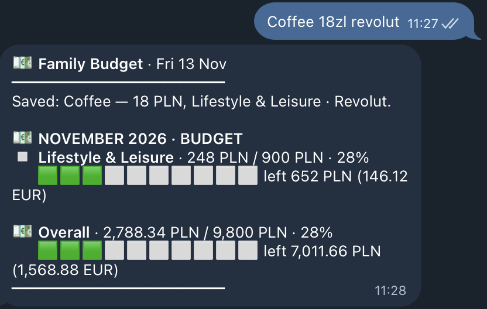
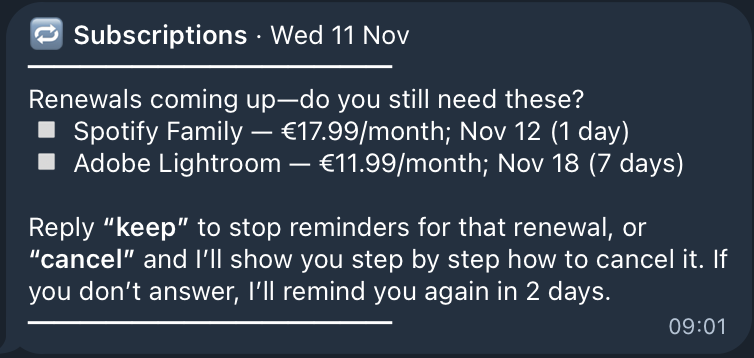
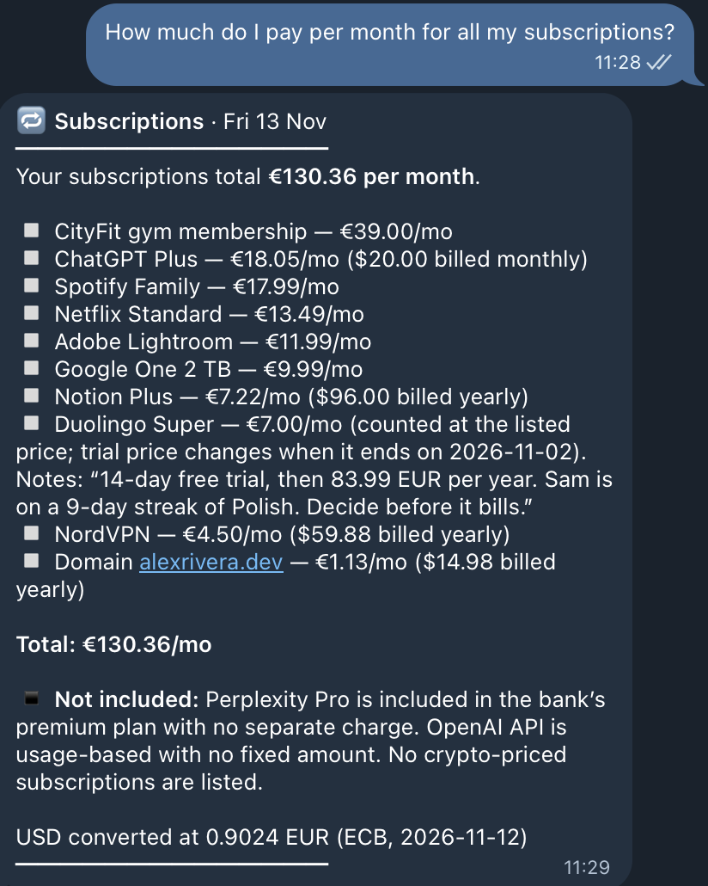
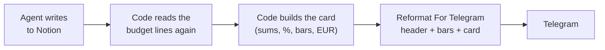
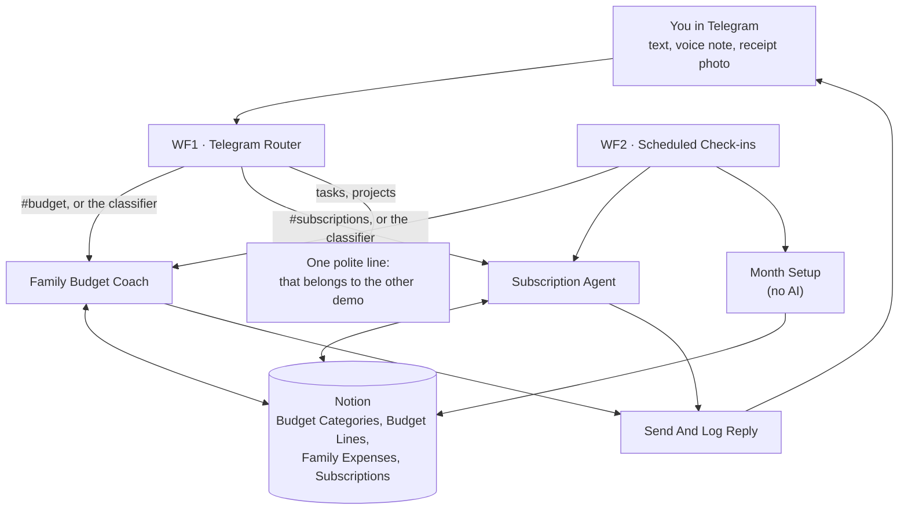
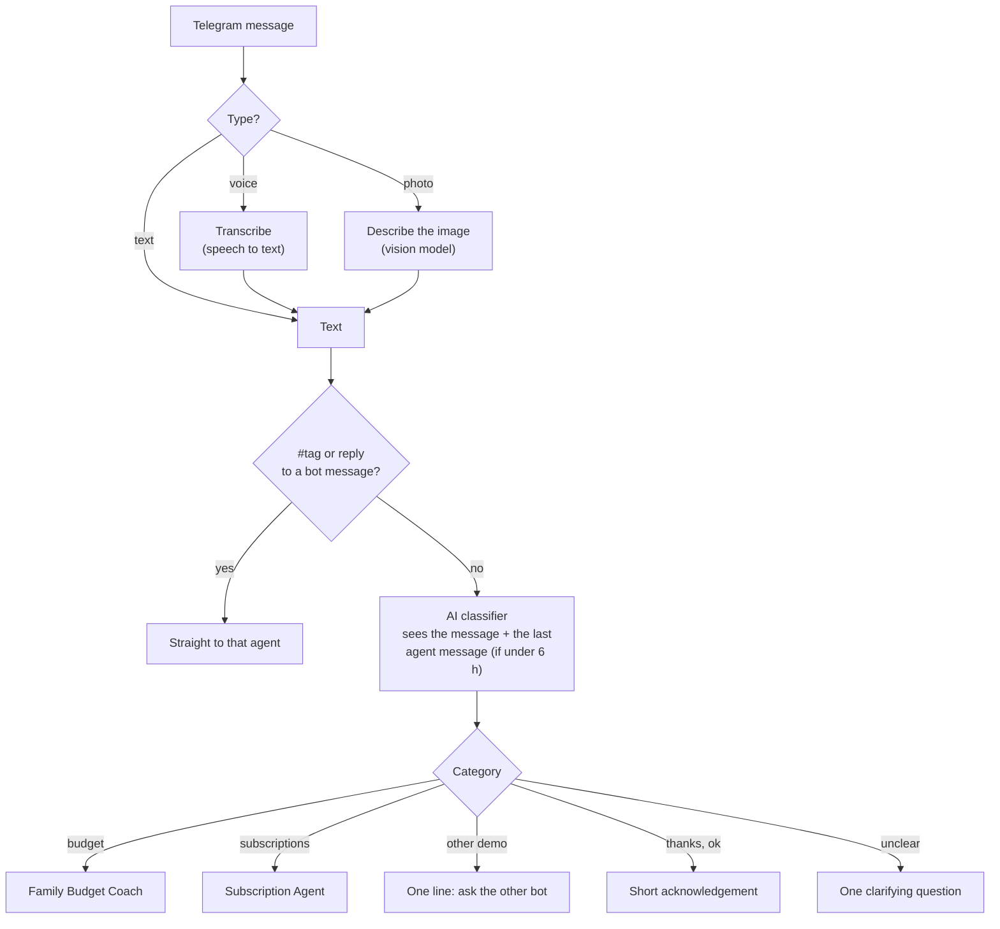
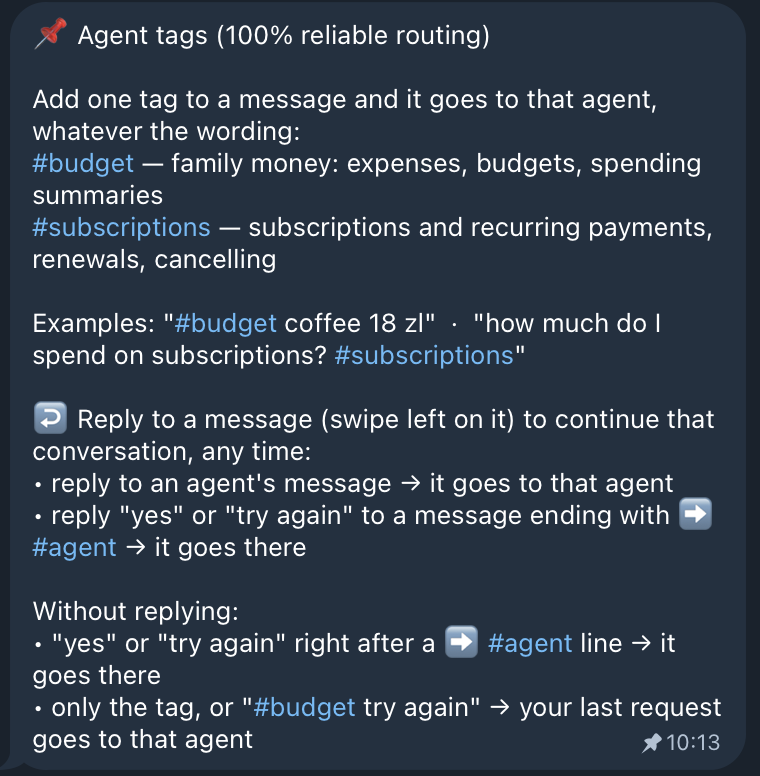
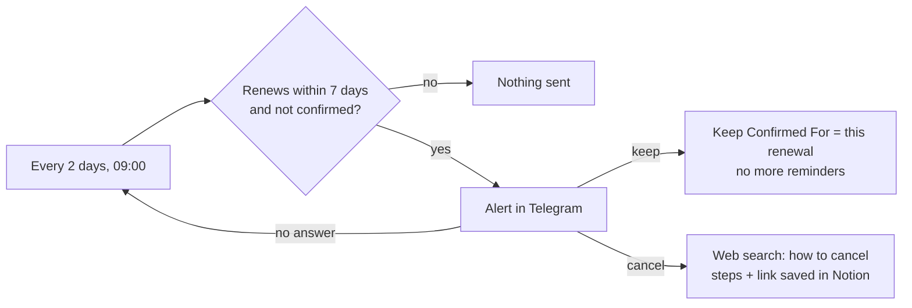
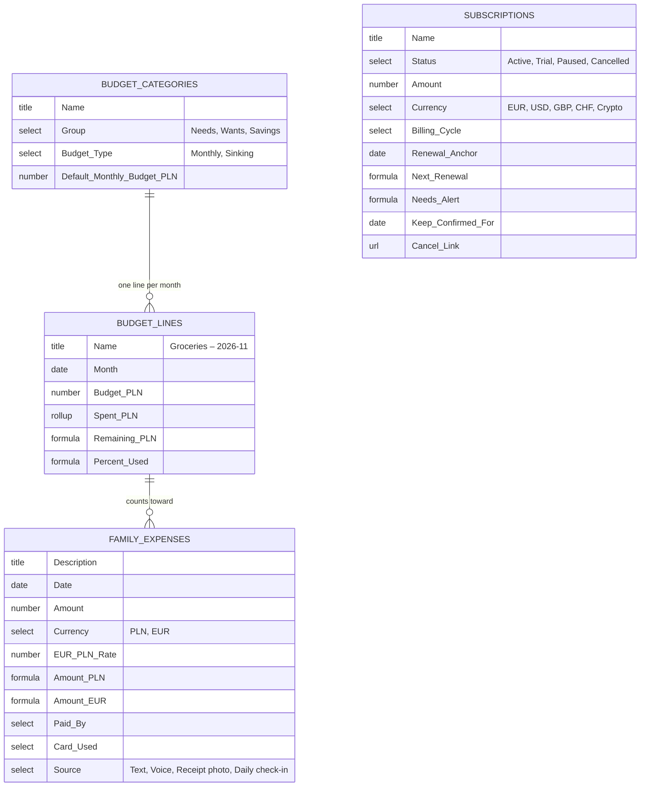

# Budget Coach

**A family budget and subscription tracker that lives in Telegram and keeps its books in Notion.**

Tell it what you spent the way you would tell a person: "coffee 18 zl revolut", a voice note, or a photo of a receipt. It logs the expense in the right category, with the card, who paid and the day's exchange rate, checks the category against its budget and warns you before you overspend. It also keeps your subscriptions and reminds you before each renewal, so you can keep it or cancel it in time.

Built with n8n: 2 AI agents, 1 router, 1 scheduler, 1 reply service, and 4 Notion tables.

> The data in this demo is invented: Alex Rivera, a freelance automation consultant in Warsaw, his partner Sam and their daughter Mia. The system is a copy of a personal assistant that runs every day for a real family.

---

## In 30 seconds

1. **Write, speak or snap.** Every Telegram message becomes text: voice notes are transcribed, receipt photos are read by a vision model.
2. **The router picks the agent.** Expenses and budgets go to the **Family Budget Coach**, subscriptions to the **Subscription Agent**.
3. **The agent reads a live snapshot from Notion** (every figure already computed in code), answers, and writes only what you asked for.
4. **You get a card**, built by code from Notion after the write: what was saved, the category bar and the monthly cap.
5. **It speaks first when it matters:** a daily check-in, a Sunday summary, a month-end review, and renewal alerts.

Two people can use the same bot. Each message is logged under the person who sent it, and "Sam paid" moves it to the other one.

---

## What it looks like

| Log an expense | Renewal alert | Subscription total |
|---|---|---|
|  |  |  |

---

## One output format, built by code

Every message from the bot has the same shape. That is a rule, not a habit of the model.

```
💶 Family Budget · Fri 13 Nov          ← agent icon, agent name, date
━━━━━━━━━━━━━━                          ← top bar
Saved: Coffee — 18 PLN, Lifestyle & Leisure · Revolut.     ← 1-2 lines from the agent

💶 NOVEMBER 2026 · BUDGET               ← the card, built by code from Notion
▫️ Lifestyle & Leisure · 248 PLN / 900 PLN · 28%
   🟩🟩🟩⬜⬜⬜⬜⬜⬜⬜ left 652 PLN (146.12 EUR)
💶 Overall · 2,788.34 PLN / 9,800 PLN · 28%
   🟩🟩🟩⬜⬜⬜⬜⬜⬜⬜ left 7,011.66 PLN (1,568.88 EUR)
━━━━━━━━━━━━━━                          ← bottom bar
```

- **The bars frame every reply**, so you see at a glance where one answer ends and the next begins, and which agent wrote it.
- **The model never writes the numbers in the card.** After the agent saves the expense, a Code node reads the budget lines from Notion and builds the card. The model writes only the short line on top.
- **The colour of the bar is the warning:** 🟩 under 80%, 🟨 from 80%, 🟥 at 100% or more.
- **Nothing is said twice:** the agent never repeats the card in its own words.



---

## The big picture



| Workflow | Starts on | Does |
|---|---|---|
| **WF1** Telegram Router | every Telegram message | turns voice and photos into text, picks the agent |
| **WF2** Scheduled Check-ins | 5 schedules | daily check-in, Sunday summary, month-end review, month setup, renewal check |
| **Family Budget Coach** | called by WF1 or WF2 | expenses, budgets, summaries |
| **Subscription Agent** | called by WF1 or WF2 | subscriptions, totals, renewals, cancelling |
| **Send And Log Reply** | called by the agents | formats the card, logs the turn, sends it |
| **Pin Tags Message** | once, by hand | pins the help message with the agent tags |

---

## WF1: how a message finds its agent



The classifier sees the previous agent message, so a short answer such as "ING for both" reaches the agent that asked the question.

### Agent tags: 100% reliable routing

The bot pins a help message in the chat. A tag skips the classifier.



- `#budget coffee 18 zl` always goes to the Budget Coach.
- **Reply to a bot message** (swipe left on it) and your answer goes to the agent that wrote it.
- When an agent cannot help, it ends its reply with a line such as `➡️ #subscriptions`. Answer "yes" and the request moves there.

---

## The two agents

### Family Budget Coach

- **Logs every expense in a message at once:** amount as written, currency (PLN unless you say EUR or €), the day's EUR/PLN rate from the National Bank of Poland, category and subcategory, card, who paid, and the source (text, voice, receipt photo, daily check-in).
- **Asks only for what is missing** (amount, what it was, card), all in one short message.
- **Warns once at 80%** of a category or of the monthly cap. **At 100% it asks:** raise the budget for this month only, from now on, or keep it.
- **Answers questions from the snapshot:** "what's left for groceries?", "how are we doing this month?", "how much did Sam spend on the Amex?". Every table can be searched on every column.
- **Two people, one bot.** Alex and Sam both write to it. "Sam paid" or "my partner paid" moves the expense to Sam.

### Subscription Agent

- **Adds, lists and totals subscriptions.** Totals per month or per year in EUR. USD, GBP and CHF are converted at the live ECB rate, in code. Trials, usage-based and plan-included services are listed apart, with the reason.
- **Renewal alerts.** Every 2 days at 09:00 it checks which subscriptions renew within 7 days. You answer:
  - **"keep"**: no more reminders for this renewal;
  - **"cancel"**: it searches the web and gives you the step-by-step way to cancel that service, and saves the cancel link in Notion;
  - **no answer**: it reminds you again 2 days later, until the renewal date.
- **Never deletes a row.** "Delete Netflix" marks it Cancelled, so the history stays.



---

## Messages it sends on its own

| When (Europe/Rome) | Agent | Message |
|---|---|---|
| Every day, 19:15 | Family Budget Coach | "What did you spend today?" Skipped if you already talked to it today. |
| Sunday, 19:30 | Family Budget Coach | Weekly summary: spent, left, categories above 80%. |
| 1st of the month, 08:00 | Family Budget Coach | Review of the month just closed, with 2-4 tips and the amount each could save. |
| 1st of the month, 06:00 | (no AI) | Month Setup: creates the new month's budget lines from the category defaults. |
| Every 2 days, 09:00 | Subscription Agent | Renewal alerts (above). |

Automatic messages never write to Notion before you reply.

---

## How it stays reliable

- **Numbers come from code.** Totals, percentages, what is left, currency conversions and projections are computed in Code nodes or by a calculator tool. The model only reads them.
- **Action log.** After each turn, the agent saves in its chat memory the Notion writes it really made, taken from the tool results, never from its own reply. If you say "try again", it skips what is already saved, so there are no duplicate expenses.
- **Three kinds of memory:**
  - the last messages of the conversation (Postgres);
  - the action log of real writes;
  - long-term Notion pages with your rules and the agent's observations. Say "remember: pharmacy counts as Health" and it applies from the next message.
- **Writes after a yes.** A proposal (a new budget, a raised cap) is written only after you confirm. A direct order ("coffee 18 zl") is written at once.
- **Errors reach you.** Every workflow is linked to an error handler. If an agent fails, you get a message that names the agent and the request, ending with a tag line, so "try again" resends it.

---

## The language model: Venice, or any provider you like

The demo uses [Venice](https://venice.ai) for every AI step:

| Step | Model call |
|---|---|
| Router classifier and both agents | chat model |
| Voice notes | speech-to-text (`/audio/transcriptions`) |
| Receipt photos | vision model (`/chat/completions` with an image) |
| "How do I cancel ...?" | chat model with Venice web search on |

**Why Venice:** a family budget is private data. Venice offers private models that, by its own policy, do not store prompts or replies, and anonymised access to other models. Pick the model that fits your privacy needs in the node settings.

**Switch to another provider.** The chat models use n8n's standard *OpenAI Chat Model* node with the Venice base URL in the credential, so any OpenAI-compatible provider works:

| Provider | What to change |
|---|---|
| **OpenAI** | an OpenAI credential with the default base URL, then pick a model in each chat model node |
| **OpenRouter** | base URL `https://openrouter.ai/api/v1` and your OpenRouter key, then pick any model it lists |
| **Anthropic** | replace each chat model node with n8n's *Anthropic Chat Model* node (it plugs into the same socket) |

The voice, vision and web search steps are HTTP Request nodes in the OpenAI format. OpenAI accepts them as they are. For web search on another provider, use its own search option, or a search API such as Perplexity.

---

## Notion: 4 tables



**How the money adds up.** Every expense links to two budget lines: its category's line for that month and the month's **Overall** line (the cap). Notion rollups then sum the spending on each line. A Code node only reads those sums and draws the bars.

**How renewals work without a script.** A subscription stores one known billing date (Renewal Anchor) and its Billing Cycle. A Notion formula rolls that date forward to the next renewal, and another formula sets **Needs Alert** when that date is within 7 days and you have not confirmed it. The renewal check only reads Needs Alert.

<details>
<summary>All columns, with types and options</summary>

**Budget Categories:** Name (title); Group (select: Needs, Wants, Savings); Budget Type (select: Monthly, Sinking; Sinking = annual cost / 12); Default Monthly Budget (PLN) (number); Budget Lines (relation, two-way with Budget Lines.Category).

**Budget Lines** (one row per category per month, plus "Overall – YYYY-MM" for the cap): Name (title); Month (date, first day); Budget (PLN) (number); Budget (EUR) (number); Category (relation; empty on Overall); Expenses (relation, two-way with Family Expenses.Budget Line); Spent (PLN) (rollup: sum of Expenses.Amount PLN); Spent (EUR) (rollup); Remaining (PLN) (formula); % Used (formula).

**Family Expenses:** Description (title); Date (date); Amount (number, as entered); Currency (select: PLN, EUR); EUR/PLN Rate (number); Amount PLN (formula); Amount EUR (formula); Budget Line (relation: the category's line and the Overall line); Related Category (relation, only for Extraordinary); Subcategory (text); Paid By (select); Card Used (select); Source (select: Text, Voice, Receipt photo, Daily check-in); Notes (text).

**Subscriptions:** Name (title); Status (select: Active, Trial, Paused, Cancelled); Amount (number, per billing cycle); Currency (select: EUR, USD, GBP, CHF, Crypto); Billing Cycle (select: Monthly, Quarterly, Every 6 months, Yearly, One-time, Usage-based); Renewal Anchor (date); Start Date (date); Payment Method (select); Use (select: Personal, Business, Both); Account (text); Auto-Renew (checkbox); Notes (text); Renewal Type (select: Date-based, Indefinite, Included in a plan, Staking-based); Value (1-5) (number); Cancel Link (url); Keep Confirmed For (date); Next Renewal (formula); Days Until Renewal (formula); Renewal (formula); Needs Alert (formula).

**Memory pages:** "Family Budget Memory" (## Budget Rules, ## Observations, ## Recent Months, ## Open Threads) and "Shared Memory" (## Profile, ## Procedures). One line per fact: `- **ID** · YYYY-MM-DD · text · src:user|observed`.

**Log table (n8n Data Table):** chat_id, agent, slot, log_date, user_message, agent_reply (text); user_message_id, reply_message_id (number).

</details>

---

## Setup

You need: a recent n8n version (the workflows use Data Tables and the MCP Client node), a Telegram bot, a Notion workspace, an OpenAI-compatible LLM key (Venice in the demo), and a Postgres database for the chat memory.

1. **Telegram:** create a bot with [@BotFather](https://core.telegram.org/bots#how-do-i-create-a-bot) and add a *Telegram API* credential in n8n. Send `/start` to the bot; your chat ID is `message.chat.id` in the first execution.
2. **Notion:** create the 4 tables and the 2 memory pages above under one page. Share that page with a Notion integration. Add a *Notion API* credential and a *Notion MCP* credential in n8n.
3. **LLM:** add an *OpenAI* credential with the base URL of your provider (Venice: `https://api.venice.ai/api/v1`).
4. **Postgres:** add a *Postgres* credential. The memory table is created automatically.
5. **Data Table:** create an n8n Data Table with the log columns above.
6. **Import** the JSON files in this order: `service-send-and-log-reply`, the two `agent-` files, `wf2-scheduled-check-ins`, `wf1-telegram-router`, `utility-pin-tags-message`. If n8n gives a workflow a new ID, select the right workflow again in each *Execute Workflow* node.
7. **Replace the placeholders.** They are in capitals:

   | Placeholder | Value |
   |---|---|
   | `YOUR_TELEGRAM_CHAT_ID` | your chat ID |
   | `YOUR_NOTION_..._DATA_SOURCE_ID` | the data source ID of each table |
   | `YOUR_NOTION_..._PAGE_ID` | the ID of each memory page |
   | `YOUR_LOG_DATA_TABLE_ID` | the Data Table ID |
   | `YOUR_ERROR_WORKFLOW_ID` | any workflow with an Error Trigger |
   | `REPLACE_WITH_YOUR_CREDENTIAL_ID` | select your credential in each node |

8. **Test** a few messages by hand, then publish WF1 and WF2 and run *Pin Tags Message* once.

---

## Try it

| You send | What happens |
|---|---|
| `coffee 18 zl revolut` | Saved under Lifestyle & Leisure. The card shows the category and the monthly cap. |
| a voice note: "groceries at Lidl, 142 zloty, ING" | Transcribed, then saved under Groceries. |
| a photo of a receipt | Read by the vision model, then saved. |
| `how are we doing this month?` | Spent against the cap, the categories above 80%, two observations. |
| `how much do I pay per month for all my subscriptions?` | The exact monthly total in EUR, one line per subscription, and what is not included. |
| `how do I cancel the gym?` | The cancellation steps found on the web, the renewal date and the saved cancel link. |
| `add a task for tomorrow` | One line: tasks belong to the [Productivity Coach](../productivity-coach/). |
