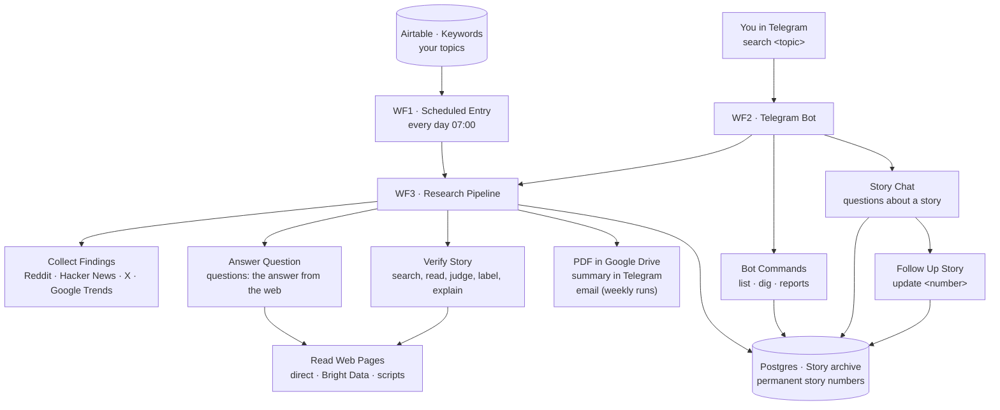
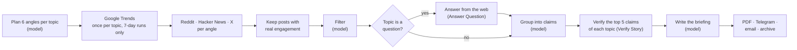
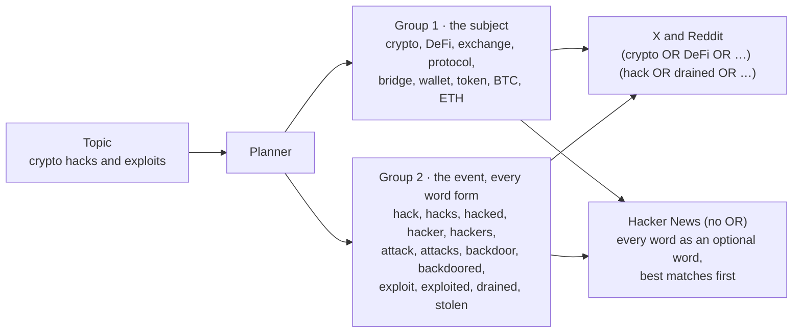
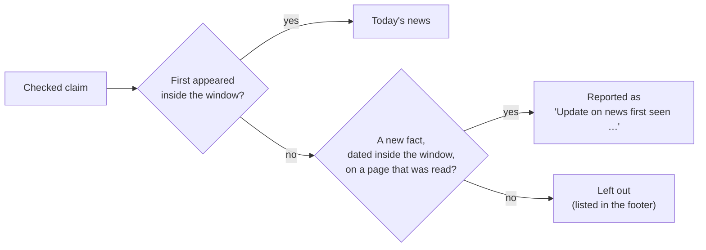
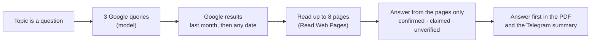
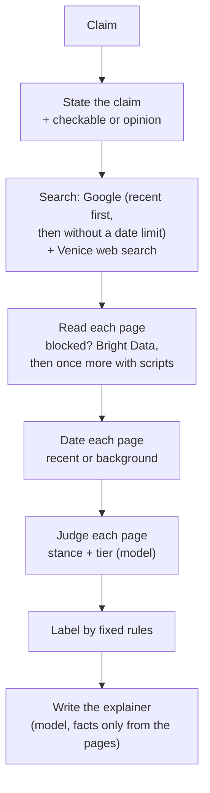
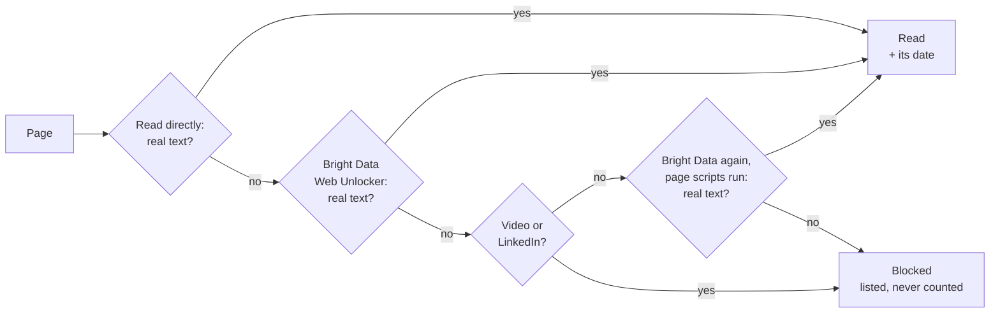
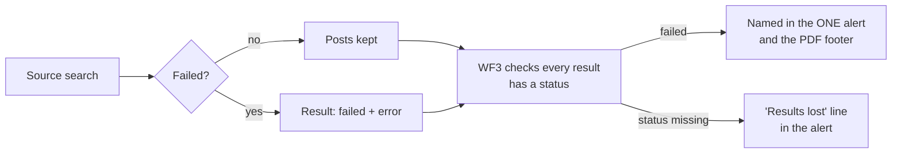
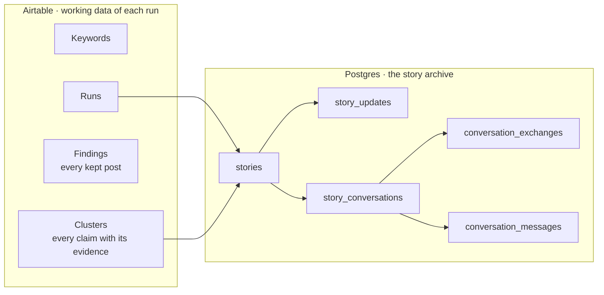

# Claim Checks

**A research desk in Telegram: what people are saying about your topics, checked against real sources, every morning.**

Pick a few topics (for example "New discoveries made with AI" or "crypto hacks and exploits"). Every morning Claim Checks reads what people posted about them on Reddit, Hacker News and X, groups the posts into claims, checks each claim against official sources and reliable news, and gives every claim a label: **Corroborated**, **Single source**, **Disputed**, **Unverified** or **Opinion**. You get a short summary in Telegram and a PDF report. Every story keeps a permanent number, so you can dig into it, ask questions about it and look for news on it later. Ask it a question instead of a topic ("what are the best projects at the NEAR hackathon?") and it also looks the answer up on the web, marking each item confirmed, claimed or unverified.

Built with n8n: 13 workflows, one Airtable base, one Postgres database and one Telegram bot.

<!-- SCREENSHOTS TO ADD (coming from the user):
     images/telegram-summary.png  - the morning summary in Telegram
     images/telegram-dig.png      - the card of one story (dig <number>)
     images/telegram-chat.png     - a question and its answer in the story chat
     images/pdf-page-1.png, pdf-page-2.png - the sample PDF report -->

---

## In 30 seconds

1. **You set the topics** in an Airtable table: keyword, daily or weekly, who gets the report. Or you send `search <topic>` to the bot, or a question: `search what are the best projects at the NEAR hackathon?`
2. **Plan:** a language model gives every topic its own 6 search angles and writes, for each one, every way people phrase it. A topic written as a question also gets its answer looked up on the web.
3. **Collect:** Reddit, Hacker News and X are searched for the posts of the last 24 hours (or 7 days); Google Trends adds what people are searching for right now. Only posts with real engagement pass.
4. **Group:** posts about the same thing become one claim.
5. **Check:** each claim is searched on Google and Venice web search; every page found is read, dated and judged (supports, contradicts or only mentions the claim; official, reliable or other).
6. **Label:** fixed rules, not the model, turn those judgements into one of five labels.
7. **Deliver:** for a question, the answer from the web comes first; then a PDF briefing in Google Drive, a summary in Telegram, an email for weekly runs, and every story saved to a searchable archive with a permanent number.
8. **Ask:** `dig 214` shows a story in full, `update 214` looks for news on it, and any question opens a conversation with a research assistant that knows the story.

---

## The big picture



| Workflow | Started by | Does |
|---|---|---|
| **WF1** Scheduled Entry | every day at 07:00 | reads the active keywords, one run per recipient and mode (`today` every day, `7days` on Mondays) |
| **WF2** Telegram Bot | a message to the bot | allowed chats only; routes commands, searches and questions |
| **WF3** Research Pipeline | WF1 or WF2 | one whole run: plan, collect, group, check, write, deliver, archive |
| **Collect Findings** | WF3: Google Trends once per topic, then once per angle and source | searches one source, keeps the posts with real engagement, filters the rest with a model, saves everything to Airtable |
| **Verify Story** | WF3, once per claim (up to 5 per topic) | finds and reads sources, judges them, gives the label, writes the explainer |
| **Answer Question** | WF3, when a topic is a question | finds the answer on the web and marks each item confirmed, claimed or unverified |
| **Read Web Pages** | Verify Story, Answer Question | reads pages and dates them; blocked pages through Bright Data, once more with the page's scripts run |
| **Ask Venice** | every model step | asks the main model, and a backup model if the first one fails |
| **Report Run Problems** | WF3, at the end | sends ONE alert if a source or a claim failed |
| **Bot Commands** | WF2 | `list`, `dig`, `reports`, `provide`, the pinned how-to |
| **Story Chat** | WF2 | the research assistant: answers questions about a story, saves or forgets conversations |
| **Follow Up Story** | Story Chat (`update`) | looks for reliable news published after the story and saves it as an update |
| **Clean Old Records** | every day at 06:30, or by hand | deletes Airtable rows no workflow reads any more, to stay under the Free plan's 1,000 records |

---

## What you set: the Keywords table

The scheduled topics live in one Airtable table. One row per topic:

| keyword | active | mode | recipient |
|---|---|---|---|
| New discovery and breakthrough made using AI and LLM | ✅ | today | you@example.com |
| crypto hacks and exploits | ✅ | today | you@example.com |
| AI regulation in the EU | ✅ | 7days | team@example.com |

- **mode `today`** runs every day at 07:00 and looks at the last 24 hours. **mode `7days`** runs on Mondays and looks at the last 7 days. Hacker News is always read over 7 days: it moves slowly.
- Topics with the same recipient and mode go into **one run and one report**.
- **active** off = paused, nothing deleted.
- **recipient** gets the PDF of weekly runs by email; the Telegram summary goes to the chat paired with that email in WF3's settings.

Topics can be broad or narrow and written in plain words: the planner turns them into proper searches (next section). From the bot, `search <topic>` starts a one-off run on anything, with no row needed.

---

## How a run works



A run with two topics takes about 20-30 minutes (29.5 in the test of 18 Nov: 69 posts kept and 10 claims checked, each check 1-3 minutes). Model and search costs grow with the number of topics, since each one gets its own 6 angles and up to 5 checks; a question adds 2 model calls, 6 Google searches and up to 8 page reads.

---

## The clever parts

### 1. Complete searches: word groups, not phrases

A search for one phrase finds only the posts that use those exact words. People write about the same event in many ways: "hacked", "drained", "exploit", "$15M stolen". So the planner never writes a phrase. For each angle it writes **2-3 word groups**, each one idea in all its common wordings, and a post is found when it contains **one word from every group**.



The **first angle of every topic is its wide angle** ("All news on crypto hacks and exploits"), so a post the narrower angles miss is still found. The engagement minimums and the model filter keep the wider searches clean.

**Every word form, because X matches whole words.** A post that says "hackers backdoored crypto teams" contains none of "hack, hacked, exploit…": X does not match "hackers" to "hack". The planner writes each form as its own word (hack, hacks, hacked, hacker, hackers; attack, attacks; backdoor, backdoored). X also returns only 20 posts per search, ranked by engagement, so the day's biggest story fills them; the main query therefore runs twice, by engagement (**Top**) and by time (**Latest**), and a newer post with fewer likes still gets in. (Found on 18 Nov: the story of North Korean hackers backdooring crypto teams through a Claude Code config file was on X with 78 likes and never reached the top 20.)

**Each angle adds new posts.** Up to 12 posts per source go to the filter; posts another angle already kept, or reported in the last 7 days, are removed first; then the best are kept, up to 5 Reddit, 4 Hacker News and 5 X posts per angle. The filter judges a post against the **topic**, not the angle, so a crypto-skimmer attack is not dropped for being "not a bridge hack".

Why it matters: with one phrase per angle, X returned 0-5 posts per crypto search and a $15.5M exchange hack slipped through. With word groups the same run returned 20 posts per search, found 78 mentions of the hack and checked it as a claim.

### 2. Every topic gets its own searches and checks

The limits are per topic: each topic gets 6 angles and its 5 strongest claims are checked. With one shared limit, a busy topic (a big hack) took the searches and checks of a quiet one (AI research), which then got 2 narrow angles and almost no stories.

### 3. Yesterday's story is not today's news

Hacker News is searched over 7 days, and a fresh article can be about an old event, so a daily report could present a week-old story as news (it did: a model release of 12 Nov in the report of 18 Nov). Now every checked claim gets the date it **first appeared**: the earliest date of its posts and of the pages that back it. If that is before the run's window:

- the model must name a **new fact** about the event (a new figure, decision, ruling, seizure, result, release, a statement by the party involved), with its date and the page that reports it. New coverage, a social post, commentary or a recap is not new;
- code then checks it: the fact's date and the page's own date must be inside the window, the page must have been read, and it must not be a social platform;
- **nothing new:** the story is left out of the report, the Telegram summary and the archive, and the PDF footer lists it under "Earlier news with nothing new";
- **something new:** it is reported as **"Update on news first seen 12 Nov: …"**, never as a new event.



In a test on 18 Nov this left out a CERN result of 9 Nov, a claim about a Maya site of 12 Nov and an FBI seizure of 12 Nov, and kept an LLM benchmark of July as an update, because its author published new results on 17 Nov.

The claims to check are also chosen fairly: the best claim of every angle first, then the rest by the number of independent sources, so a security story is not pushed out by product launches.

### 4. A question gets an answer, not just a check

Posts rarely hold the answer to a question such as "what are the best projects at the NEAR hackathon?": the organiser's project list, results pages and coverage do. When a topic starts with a question word or ends with "?", the planner aims its angles at the answer, and **Answer Question** writes 3 Google queries (the official source, the answer in people's words, coverage), reads up to 8 pages and lists the answers. Each one is marked **confirmed** (the organiser, an official source or a news outlet says it), **claimed** (only its own team says it) or **unverified** (blogs, forums, a search snippet), with dated links. The answer opens the PDF and the Telegram summary; the posts are still checked as usual.



### 5. Google Trends with a short term

Google Trends has no data for long phrases, so each topic's wide angle gets a 1-2 word **Trends term** ("crypto hack", "drug discovery"). The rising searches around it are offered to a small model that keeps at most 2 that really belong to the topic ("crypto hack north korea" stays, "blooket join" goes). Those terms become extra searches for the run.

**Only for 7-day searches.** Google Trends is asked only on Monday's weekly run and on searches from the bot, never on the daily run: over 16 runs in November a 1-day window gave rising searches only 3 times, all weak, while using most of SerpApi's free monthly allowance. The word groups already cover the ways people write about a topic.

### 6. The label comes from rules, not from the model

The model only judges each page: does it **support**, **contradict** or **only mention** the claim, and is it **official**, a **reliable outlet** (an editable list of newsrooms) or **other**. Then fixed rules give the label:

| Label | Rule |
|---|---|
| **Corroborated** | 2+ independent domains support it, at least one official or reliable, nothing trustworthy contradicts it |
| **Single source** | exactly one supporting domain, official or reliable: the usual label for fresh news |
| **Disputed** | an official or reliable source contradicts it |
| **Unverified** | a checkable claim with no trustworthy support |
| **Opinion** | a view, not a checkable fact |

Links on the platforms where the story was found (Reddit, Hacker News, X), Facebook and Instagram posts, and copies of the original post never count as evidence.



### 7. Every source has a date; old pages are marked "background"

Each page gets its publication date from its own metadata, else from its address, else from Google's date; never guessed from the text. A page older than the run's window (7 days for a daily run, 30 for a weekly one) is shown as **background**, and the writers may use it only as earlier context, never as the news. Google is searched for recent pages first, so fresh coverage comes before old articles about the same subject.

### 8. Pages that block automated reading

Every page is first read directly. Only a page that refuses (blocked, rate-limited, empty) is read again through **Bright Data's Web Unlocker**. Some pages load their text with scripts (an official blog, for example), so the unlocker returns an empty shell: those get **one more try with `render`**, where Bright Data runs the page's scripts first. It is slower, so it is used only for pages still without text, and never for video or LinkedIn pages. A page that still cannot be read is listed as blocked, so you can open it yourself, but it never counts. One shared workflow, "Read Web Pages", does this for both the claim checks and the answers.



### 9. One story, one number, forever

Every checked claim is saved to the story archive with a **permanent story number**: story 214 is the same story in the morning summary, in `list`, `dig` and `update`, at any time. When a later run finds a post (or the article a post links to) that an archived story already has, it is the **same story**: it keeps its number, gets the new label, and a dated "checked again" entry is added to its history. Stories are never merged on a guess.

### 10. A conversation about each story

After `dig` or `update`, any message is a question about that story. The answer comes from a reasoning model (Kimi K2.6 on Venice, with a backup model) that can search the web, read pages, search the archive with read-only SQL and look up the run records. Its order of trust: the checked story and its updates first, then your saved conversations, then fresh web results; a fresh source that contradicts the story is shown with both sides. It never presents another post as the story's original post.

Nothing is saved automatically. `save` keeps a summary of the conversation, `close` saves and ends it, `forget` drops it. Replying to any old message brings that conversation back, with its story.

### 11. Built to survive failures

- Every model call goes through **Ask Venice**: the main model, then a backup model if the first fails or returns broken output.
- A source that fails does not stop the run: the report says which source failed.
- **No silent failures:** see the next part.
- **One alert per run** (Report Run Problems), not one per failure.


### 12. No silent failures

A report that quietly misses a source looks exactly like a good one, so every failure is named:

- A source that is down (a service error, a network drop) does not stop its search: "Collect Findings" returns **failed** with the error, the run goes on with the other sources, and the alert and the PDF footer say which source, for which angle, and why (for example `X for "All news on crypto hacks and exploits" failed: getaddrinfo ENOTFOUND …`). When only some searches of a source fail, the alert says how many, and the rest are used.
- n8n itself can lose the results of a whole step when one sub-workflow fails inside it (it hands back its inputs instead). The run checks that every result has a status; if results are missing, it says so ("results of 6 of 6 source calls lost") instead of looking clean.
- A question that could not be answered, and a claim that could not be checked, are listed the same way.


---

## The Telegram bot

Commands work with or without a symbol in front: `search`, `/search` and `#search` are the same.

| You send | What happens |
|---|---|
| `/start` or `help` | the how-to message, pinned in the chat |
| `search <topic>` | a run on that topic (last 7 days; add "today" for the last 24 hours). The summary and the PDF link arrive when it is done |
| `search <question>` | the same run, plus an answer from the web at the top of the summary and the PDF, e.g. `search what are the most revolutionary projects submitted to the NEAR hackathon?` |
| `list` | the stories of the last 7 days, by day: number, label, title |
| `list <dates>` | the stories in a date range, e.g. `list 13 October - 21 October 2026` (dates read by fixed rules, not a model) |
| `dig <number>` or `dig <words>` | the full story: where it came from (the original posts, with dates), what happened, what is confirmed and what is not, why it matters, every source with its date, every update, your saved conversations |
| `update <number>` | looks for reliable news published since the story or its last update, and saves what it finds |
| `reports` | the reports of the last 14 days; a number alone opens one |
| `provide`, `provide-all` | the summary or the full version of a report |
| `save`, `close`, `forget` | keep or drop the current conversation |
| anything else | a question in the current conversation |

Only the chat ids listed in WF2's settings can use the bot; any other chat is ignored.

<!-- images/telegram-dig.png and images/telegram-chat.png go here -->

---

## The report

One PDF per run, saved in a Google Drive folder:

- a short front page that explains the five labels and lists the topics, the window and the search terms used (Google Trends terms included);
- for a question, the **Answer** first: a direct answer, then each item (a project, a team, a reason) with its status (confirmed, claimed by its team, unverified) and its dated links, and what could not be found;
- the **briefing**, by topic, with the label next to each statement, and "the other side" for each topic;
- one entry per story: its number, label, where it came from (the original posts first, with author and date), what happened, what is confirmed and what is not, why it matters, the open question, and every source with its date;
- the numbered source list, and a footer with the sources that returned nothing or failed, each failure with its error.

<!-- images/pdf-page-1.png and images/pdf-page-2.png go here -->

---

## Where the data lives



**Airtable** keeps the working data of each run, readable by a person: the topics, each run, every post kept and every claim with its evidence. You can open it and see why a post was dropped.

**Airtable stays small, on the Free plan.** Its Free plan allows 1,000 records per base, and a run with two topics saves about 95 rows. **Clean Old Records** runs every day at 06:30, before the morning run, and deletes the rows no workflow reads any more; the archive in Postgres keeps everything that lasts:

| Rows | Kept for | Why that long |
|---|---|---|
| dropped posts | not saved | nothing reads them after the run (since 18 Nov) |
| kept posts | 7 days | the "already reported" check looks back 7 days |
| Clusters (claims) | 14 days | the bot's `reports` list goes back 14 days |
| Runs | 14 days | same |
| Keywords | always | your topics |

That holds the base at about 500 rows with two daily topics (room for about four). The days are settings; `count_only` shows what would be deleted without deleting. It finds old rows page by page and deletes 10 per request, 4 requests a second (Airtable allows 5), each table in its own execution (the workflow calls its own block), so it scales with the data. Deleted rows go to Airtable's trash.

**Postgres** keeps the **story archive**: what the bot reads and what lasts.

| Table | One row per | What it is for |
|---|---|---|
| `stories` | checked story | the permanent number, label, claim, explainer, sources with their dates, the original posts, the PDF link; a full-text index (title, claim, summary, keywords, search words, explainer) so `dig <words>` finds a story by its words |
| `story_updates` | follow-up or "checked again" | the story's history, shown by `dig` |
| `story_conversations` | conversation with the bot | which story it is about, whether it is the active one, the saved summary |
| `conversation_exchanges` | question and answer | the conversation itself, so a later question has its context |
| `conversation_messages` | Telegram message | links each message to its conversation, so replying to an old message continues it |

Why Postgres and not more Airtable tables: the archive grows every day and is searched with SQL (word search, date ranges, a story's whole history in one query), and the chat agent searches it with **read-only SQL** through its own login (`cc_reader`), which can read the archive and nothing else.

---

## Setup

### 1. Airtable

Create a base with four tables. Field names exactly as written (snake_case); select options as listed.

| Table | Fields |
|---|---|
| **Keywords** | keyword (text), active (checkbox), mode (single select: today, 7days), recipient (email) |
| **Runs** | run_id (text), started_at (date-time), status (single select: started, collecting, merging, verifying, delivered, failed), keywords (long text), mode (single select: today, 7days), recipient (email), pdf_link (url), last_opened_at (date-time), briefing (long text) |
| **Findings** | title (text), run_id (text), angle (text), source (single select: reddit, hacker_news, x), url (url), linked_url (url), published_at (date-time), summary (long text), kept (checkbox), drop_reason (text), cluster_id (text) |
| **Clusters** | title (text), run_id (text), cluster_id (text), sources (multiple select: reddit, hacker_news, x), independent_domains (number), label (single select: Corroborated, Single source, Disputed, Unverified, Opinion), official_links (long text), supporting_links (long text), evidence (long text), reason (long text), gist (long text), explainer (long text), story_number (number, 0 decimals) |

### 2. Postgres: the story archive

Any Postgres works; the commands below are for Postgres in Docker. The script `database/claim-checks-database.sql` creates the `claim_checks` schema with its five tables, keys and indexes (the same layout as the running system), and the read-only login `cc_reader`. It runs in one transaction: all or nothing.

Find your container and database (the database your n8n Postgres credential uses):

```bash
docker ps --format '{{.Names}}' | grep -i postgres
```

Create the tables (replace `n8n-postgres` and `n8n_memory` with your container and database):

```bash
docker exec -i n8n-postgres psql -U "$(docker exec n8n-postgres printenv POSTGRES_USER)" -d n8n_memory -v ON_ERROR_STOP=1 < database/claim-checks-database.sql
```

Give the read-only login a password (you type it twice, hidden):

```bash
docker exec -it n8n-postgres psql -U "$(docker exec n8n-postgres printenv POSTGRES_USER)" -d n8n_memory -c "\password cc_reader"
```

Check that the five tables exist:

```bash
docker exec n8n-postgres psql -U "$(docker exec n8n-postgres printenv POSTGRES_USER)" -d n8n_memory -c "\dt claim_checks.*"
```

Back up the database first if it already holds other data:

```bash
docker exec n8n-postgres pg_dump -U "$(docker exec n8n-postgres printenv POSTGRES_USER)" -d n8n_memory > backup-before-claim-checks.sql
```

### 3. Credentials

| Credential (n8n type) | Used by |
|---|---|
| Airtable Personal Access Token | every Airtable call |
| Postgres (owner login) | saving and reading the archive |
| Postgres (`cc_reader`, the password from step 2) | the chat agent's read-only archive search |
| Telegram (a new bot from @BotFather) | WF2, summaries, alerts |
| OpenAI API pointed at Venice (`https://api.venice.ai/api/v1`) | every model step (Ask Venice) and the chat agent |
| SerpApi | Google Trends |
| Header Auth `x-api-key` (ScrapeCreators) | Reddit search |
| Header Auth `x-api-key` (twitterapi.io) | X search |
| Header Auth `X-API-KEY` (Serper) | Google search in Verify Story, Follow Up Story and the chat |
| Header Auth `Authorization: Bearer …` (Bright Data) | reading blocked pages (Web Unlocker zone) |
| Google Drive OAuth2 | the PDF report |
| Gmail OAuth2 | the weekly email |

Hacker News needs no key.

### 4. Import and link the workflows

Import the ten JSON files. Every node that calls another workflow is named `… (via <Workflow Name>)`: open each one and choose that workflow from the list (imported workflows get new ids). In the settings of each called workflow, "This workflow can be called by" lists its callers: add the new ids of its callers there.

### 5. Placeholders

| Placeholder | Where | What to put |
|---|---|---|
| `REPLACE_WITH_YOUR_CREDENTIAL_ID` | every credentialed node | pick your credential in the node |
| `YOUR_AIRTABLE_BASE_ID` | every Airtable call | the `app…` id from your base's URL |
| `YOUR_AIRTABLE_KEYWORDS_TABLE_ID`, `..._RUNS_...`, `..._FINDINGS_...`, `..._CLUSTERS_...` | the Airtable calls | each table's `tbl…` id from its URL |
| `YOUR_DRIVE_REPORTS_FOLDER_ID` | WF3 Store Settings | the Drive folder for the PDFs: `.../folders/THIS_PART` |
| `YOUR_TELEGRAM_CHAT_ID` and `you@example.com` | WF2 Store Settings (`allowed_chats`), WF3 Store Settings (`recipient_chats`) | your chat id and the email paired with it; add one pair per person |
| `mcp_unlocker` | Store Settings of Verify Story, Follow Up Story and Story Chat | the name of your Bright Data Web Unlocker zone |
| `YOUR_ERROR_WORKFLOW_ID` | workflow settings → Error workflow, in 7 of the 10 workflows | your error handler (for example the [Error Handling](../error-handling/) system), or leave it empty. Collect Findings, Verify Story and Ask Venice have none on purpose: their failures are reported once by the run (Report Run Problems) |

### 6. Start

1. Activate WF2 and send `/start` to the bot: the how-to message is pinned.
2. Send `search <any topic> today` for a first run.
3. Add your topics to Keywords and activate WF1 for the daily runs.

---

## Settings you may want to change

| Setting | Where | Default |
|---|---|---|
| reliable outlets (the newsroom list) | Verify Story · Store Settings | Reuters, AP, BBC, Guardian, NYT, FT, Bloomberg, The Verge, TechCrunch, Nature, Science and others |
| angles per topic | WF3 · Store Settings `max_angles` | 6 |
| claims checked per topic | WF3 · Store Settings `max_verify` | 5 |
| pages read for an answer | Answer Question · Store Settings `max_pages` | 8 |
| days Airtable rows are kept | Clean Old Records · Store Settings | dropped posts 1, kept posts 7, Clusters 14, Runs 14 |
| posts kept per angle | Collect Findings · Store Settings | Reddit 5, Hacker News 4, X 5 (from a pool of 12 per source) |
| engagement minimums | Collect Findings · Store Settings | Reddit score 20 and 5 comments (daily), X 50 likes and 2 reposts (daily); doubled for weekly runs |
| pages read per claim | Verify Story · Store Settings `max_candidates` | 8 |

---

## Known limits

- **Only what people discuss.** A story nobody posts about with some engagement is not found; that is the point (what people talk about), but it means quiet official news can be missed.
- **A run is a snapshot.** News that breaks after the 07:00 run is found by the next run, or by `search` in the bot.
- **Some pages cannot be read or dated**: Facebook and Instagram posts, and a few publishers that block even the unlocker. They are listed, never counted.
- **One question per run.** If several topics of one run are questions, only the first gets an answer from the web; the others are searched as topics.
- **Labels describe the sources, not the truth.** "Corroborated" means independent trustworthy sources back the claim at the time of the run.

---

## Files

| File | What it is |
|---|---|
| `wf1-scheduled-entry.json` | WF1 · Scheduled Entry: the daily and Monday runs from the Keywords table |
| `wf2-telegram-bot.json` | WF2 · Telegram Bot: allowed chats, commands, searches, questions |
| `wf3-research-pipeline.json` | WF3 · Research Pipeline: one whole run |
| `service-collect-findings.json` | Collect Findings: one source for one angle |
| `service-verify-story.json` | Verify Story: sources, judgement, label and explainer for one claim |
| `service-ask-venice.json` | Ask Venice: every model call, with a backup model |
| `service-report-run-problems.json` | Report Run Problems: one alert per run |
| `service-bot-commands.json` | Bot Commands: list, dig, reports, provide, help |
| `agent-story-chat.json` | Story Chat: the research assistant and its saved conversations |
| `service-follow-up-story.json` | Follow Up Story: `update`, news since the story |
| `service-answer-question.json` | Answer Question: the answer to a question topic, from the web |
| `service-read-web-pages.json` | Read Web Pages: page text and dates, Bright Data for blocked pages |
| `wf-clean-old-records.json` | Clean Old Records: daily Airtable cleanup (schedule or by hand) |
| `database/claim-checks-database.sql` | the Postgres tables of the story archive and the read-only login |
| `images/` | screenshots |
