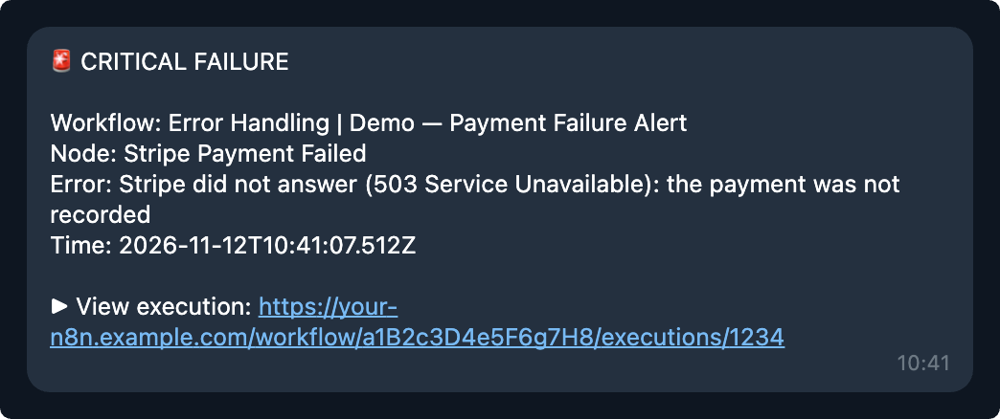
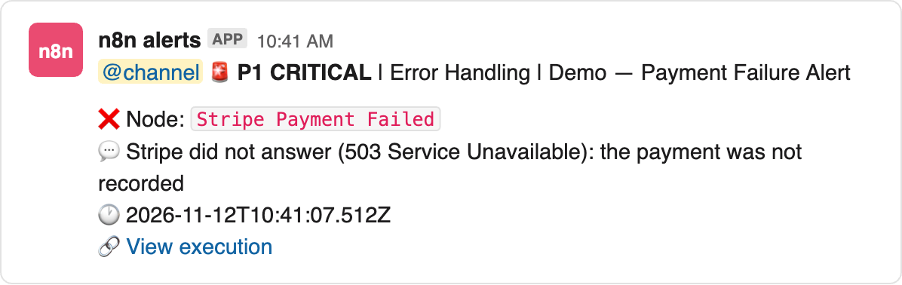
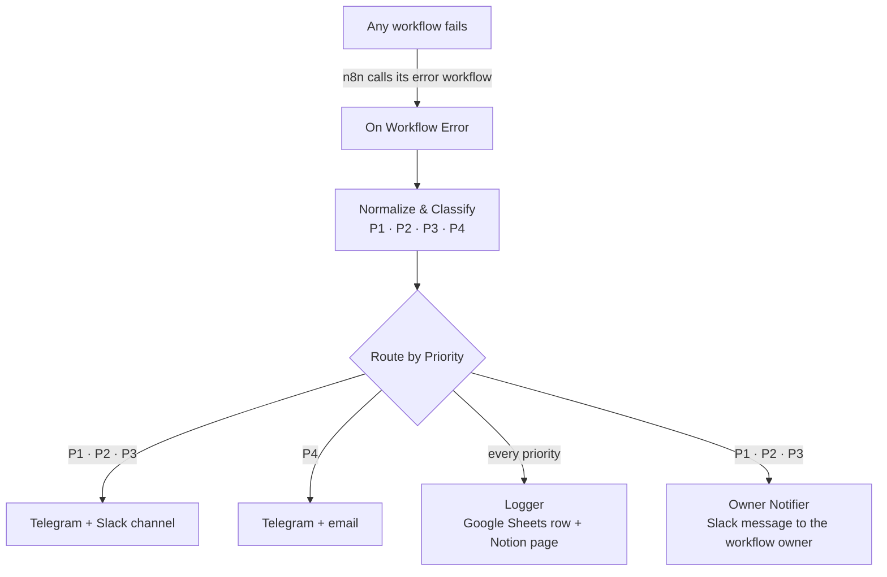
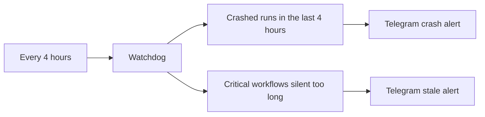
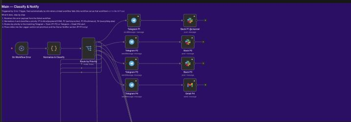
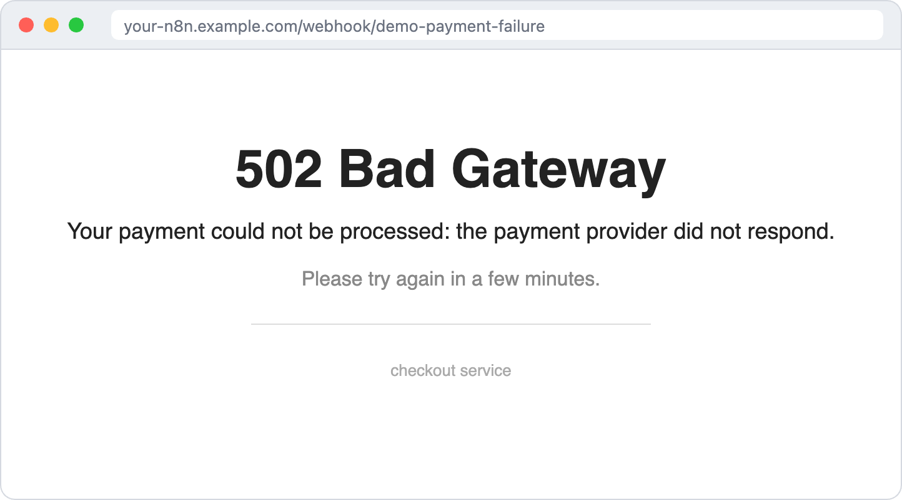

# Error Handling

**One error handler for every n8n workflow: it rates each failure P1 to P4 and alerts the right people in the right place.**

When a workflow fails, n8n hands the error to this handler. It decides how serious the failure is, sends a Telegram alert, posts to Slack or sends an email depending on the priority, logs the failure to Google Sheets and Notion, and messages the owner of the failed workflow. A separate watchdog catches the failures the handler cannot see, such as a run killed by an out-of-memory crash.

Built with n8n: 1 error handler, 1 watchdog, 1 demo workflow.

<p align="center"><a href="https://youtu.be/4jvEd0MRxfE"></a><br><b>▶ <a href="https://youtu.be/4jvEd0MRxfE">Watch the demo on YouTube</a></b></p>

---

## In 30 seconds

1. **Connect once.** In any workflow, choose this handler under Settings → Error workflow. No extra nodes.
2. **A workflow fails.** n8n starts the handler with the error: workflow, node, message, link to the run.
3. **Rate it.** Rules rate the failure P1 (critical) to P4 (low): payment problems are P1, login problems P2, server errors P3.
4. **Alert by priority.** Every failure goes to Telegram. P1 to P3 also go to a Slack channel per priority (P1 with `@channel`). P4 goes by email.
5. **Log it.** Every failure becomes a row in Google Sheets and a page in a Notion table, so nothing is lost in a chat.
6. **Tell the owner.** For P1 to P3, if the failed workflow has an `owner:` tag, that person gets a Slack message.
7. **Watch for the silent ones.** The watchdog checks every 4 hours for crashed runs and for critical workflows that stopped running.

---

## What it looks like

<table>
<tr>
<td align="center" width="50%"><br><i>Telegram: every priority.</i></td>
<td align="center" width="50%"><br><i>Slack: P1 to P3, one channel each.</i></td>
</tr>
</table>
<p align="center"><sub>Alerts recreated from the demo run, in the exact format the workflow sends.</sub></p>

---

## The big picture





| Workflow | Runs | Does |
|---|---|---|
| **Main — Error Handler** | when a connected workflow fails | rates, alerts, logs, tells the owner |
| **Watchdog** | every 4 hours | finds crashed runs and silent critical workflows |
| **Demo — Payment Failure Alert** | when you open its link | fails on purpose, to show the handler in a demo |

<p align="center"><br><sub>The Classify & Notify section of the error handler in n8n.</sub></p>

---

## How the priority is chosen

The `Normalize & Classify` node checks these rules in order. The first rule that matches wins.

| # | When | Priority |
|---|---|---|
| 1 | The node name or the error message says `P1`, `P2`, `P3` or `P4` | that priority |
| 2 | Payment words: payment, stripe, charge, invoice, billing | **P1** |
| 3 | Out of memory, killed, SIGKILL | **P1** |
| 4 | Status 401 or 403, "unauthorized", "forbidden" | **P2** |
| 5 | Sync, CRM, import or export | **P2** |
| 6 | Any other 4xx status | **P2** |
| 7 | 5xx status, connection reset, timeout | **P3** |
| 8 | Anything else | **P4** |

**AI agents get one more rule.** When the failure is in an AI agent, a tool or the model (or in a workflow named agent, coach or router), a broken output format is **P1**, because it is a new bug. Any other agent failure is at least **P2**, because the agent cannot work.

To force a priority for a known failure, put `P1` (or `P2`, `P3`, `P4`) in the node name or in the error message.

| Priority | Telegram | Slack | Email | Sheet + Notion | Owner message |
|---|---|---|---|---|---|
| P1 critical | ✅ | ✅ with `@channel` | | ✅ | ✅ |
| P2 high | ✅ | ✅ | | ✅ | ✅ |
| P3 medium | ✅ | ✅ | | ✅ | ✅ |
| P4 low | ✅ | | ✅ | ✅ | |

---

## The watchdog

The error handler only runs when n8n itself reports an error. Some failures never get that far: a run killed by an out-of-memory crash, or a workflow that simply stopped running. The watchdog covers those two cases.

1. **Crashed runs.** It asks the n8n API for runs with status `crashed` in the last 4 hours and sends a Telegram alert for each one.
2. **Silent workflows.** It checks a list of critical workflows for the time since their last successful run, and alerts when one has been silent too long.

The list in `Stale Workflow List` is empty. Add only workflows that can fail silently:

```js
const criticalWorkflows = [
  { id: 'YOUR_WORKFLOW_ID', name: 'Stripe Payment Sync', maxMinutesSinceSuccess: 780 }
];
```

---

## The demo

`Demo — Payment Failure Alert` shows the handler with a realistic failure:

1. You open the link `GET /webhook/demo-payment-failure` in a browser.
2. `Record Stripe Payment` calls a test address that always answers 503.
3. The browser gets a **502 Bad Gateway** page.
4. `Stripe Payment Failed` stops the run with an error. The name contains "Stripe Payment", so the handler rates it **P1**: Telegram, Slack with `@channel`, a Sheet row and a Notion page.

<p align="center"></p>

Open the link, do not press Execute: runs started from the editor never call the error workflow. Activate the demo only while you record, because anyone with the link can raise a P1 alert.

---

## Setup

### 1. Import

Import `error-handler.json`, `watchdog.json` and, if you want it, `demo-payment-failure.json` (see [How to import a workflow](../README.md#how-to-import-a-workflow)).

### 2. Credentials

| Credential | Used by |
|---|---|
| Telegram | all Telegram alerts (handler and watchdog) |
| Slack | Slack P1, P2, P3 and the owner message |
| Gmail | the P4 email |
| Google Sheets | the log row |
| Notion | the log page |
| Header Auth, header `X-N8N-API-KEY`, value = an n8n API key (n8n: Settings → n8n API) | `Get Workflow Tags`, `Get Crashed Executions`, `Get Last Success` |

### 3. Placeholders

| Placeholder | Where | What to put |
|---|---|---|
| `YOUR_TELEGRAM_CHAT_ID` | every Telegram node | the chat that receives the alerts |
| `YOUR_SLACK_P1_CHANNEL_ID`, `..._P2_...`, `..._P3_...` | Slack P1, P2, P3 | one channel per priority (Slack: channel details → Channel ID) |
| `YOUR_ALERT_EMAIL` | Gmail P4 | where the low-priority email goes |
| `YOUR_SPREADSHEET_ID` | Append to Google Sheets | the ID from the sheet URL: `.../d/THIS_PART/edit` |
| `YOUR_NOTION_DATABASE_ID` | Create Notion Page | the ID of your alerts table, shared with your Notion integration |
| `YOUR_NAME` | Extract Owner | your own `owner:` tag; you already get the priority alerts, so you get no extra message |
| `YOUR_N8N_URL` | watchdog alert texts | the address of your n8n |

**Google Sheet:** a tab named `Sheet1` with the header row
`timestamp, priority, workflowName, workflowId, executionId, executionUrl, failedNode, errorMessage, statusCode`.

**Notion table:** the title is the workflow name, plus these properties: `Severity` (select: P1–P4), `Status` (status, with the option `New`), `Workflow` (text), `Triggered At` (date), `Description` (text), `Execution URL` (URL), `Failed Node` (text).

**Workflow owners:** tag a workflow `owner:anna`, then add Anna's Slack member ID to `Lookup Slack ID`:

```js
const ownerLookup = {
  'anna': { slackId: 'U0123456789' }
};
```

**n8n API address:** the API nodes call `http://localhost:5678/api/v1/...`. This works when n8n runs on port 5678 on the same machine or container. Otherwise, change it to your n8n address.

### 4. Connect your workflows

1. Open the error handler: Settings → Error workflow → choose **Main — Error Handler** itself. If a node inside the handler fails, it then reports on itself.
2. In every workflow you want to watch: Settings → Error workflow → **Main — Error Handler**.
3. Publish the error handler. Publish the watchdog only when you have critical workflows in its list.

---

## Known limits

- Runs started with the **Execute** button in the editor do not call the error workflow. Test with a real trigger.
- The Notion step retries 3 times, 3 seconds apart, because Notion can answer "too many requests" when several alerts arrive at once.
- The watchdog's crash check only sees crashes that the n8n API reports with status `crashed`.

---

## Files

| File | What it is |
|---|---|
| `error-handler.json` | Main — Error Handler: classify, alert, log, tell the owner |
| `watchdog.json` | Watchdog: crashed runs and silent workflows, every 4 hours |
| `demo-payment-failure.json` | Demo — Payment Failure Alert: a failure on purpose, for demos |
| `images/` | screenshots |
