# GHL Store Automation

**Connect a Shopify store to GoHighLevel so every lead and customer moves through the sales pipeline on their own.**

A store owner loses sales in the gaps: a contact-form question that waits a day for an answer, a cart left at checkout, a customer who bought once and never came back. This system closes those gaps. Every store event becomes a GoHighLevel contact in the right pipeline stage, and the right message goes out at the right time: an instant reply to a new lead, a reminder for an abandoned cart, a win-back email to a customer who went quiet.

Built with n8n: 1 main workflow, 4 event handlers, 3 services, a contact form and a demo simulator; 4 n8n Data Tables.

> Tested end to end against a real Shopify development store and a real GoHighLevel sandbox. The names and emails in the images are test data.

---

## In 30 seconds

1. **One intake for everything.** Shopify webhooks, the shop's contact form and the daily schedule all enter one main workflow. It checks Shopify's signature and sends each event to its handler.
2. **Pipeline stages move on their own.** New Lead → Contacted → Cart Created → Purchased → Repeat Customer. A contact never moves backwards.
3. **The right message, once.** A lead gets a reply in seconds. An abandoned cart gets one reminder after 1 hour, never two. A customer quiet for 60 days gets a win-back email, then a follow-up 7 days later.
4. **Email always, SMS as an extra.** Every message goes by email; when the customer gave a phone number, an SMS goes too.
5. **Proof, not promises.** A Demo Simulator plays five customers against the real workflows and shows a PASS/FAIL table.

---

## What it looks like

| | |
|---|---|
| **The pipeline in GoHighLevel** | **The cart reminder email** |
| 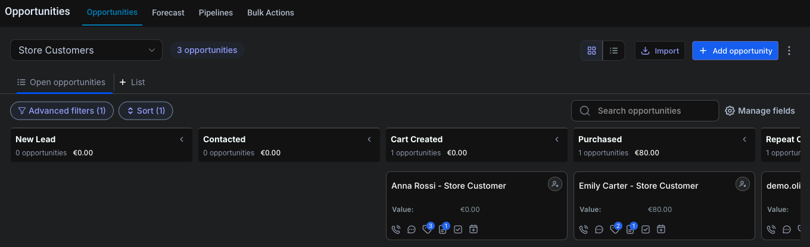 | 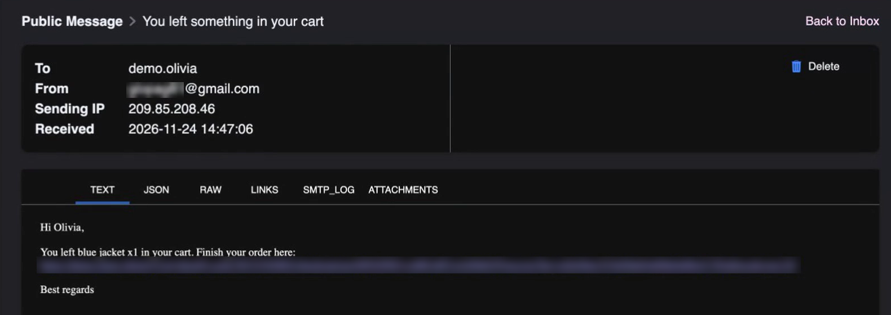 |
| **The Demo Simulator result** | **The contact form on the shop** |
| 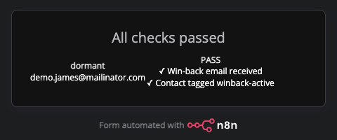 | 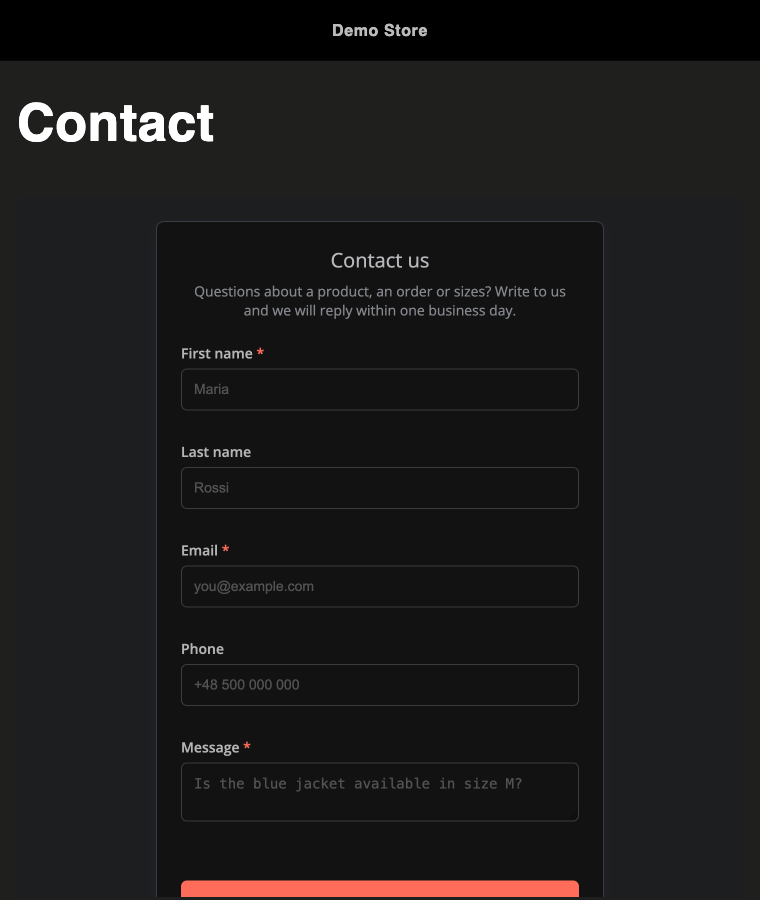 |

---

## The messages

Every template lives in a handler and is plain text you can change. `{offer}`, `{store_url}` and `{response_time}` come from the **Store Settings** node.

| When | Channel | Subject / text |
|---|---|---|
| A contact form arrives | Email | **Thanks for reaching out, {first_name}** · "…we received your message and will reply within {response_time}. In the meantime you can browse our store: {store_url}" |
| | SMS (if phone) | "Hi {first_name}, thanks for reaching out - we will reply within {response_time}." |
| A cart is still open after the wait | Email | **You left something in your cart** · "You left {cart_items} in your cart. Finish your order here: {recovery_url}" |
| | SMS (if phone) | "Hi {first_name}, you left {cart_items} in your cart. Finish your order here: {recovery_url}" |
| Last order 60 days ago | Email | **We miss you, {first_name}** · "It has been a while since your last order… {offer} Visit us: {store_url}" |
| 7 days later, still no order | Email | **A little something for you, {first_name}** · "We wanted to follow up: {offer}" |
| | SMS (if phone) | "Hi {first_name}, it's been a while! {offer} - {store_url}" |

In the GoHighLevel sandbox an SMS is not sent (a sandbox has no phone number): it is saved on the contact as a note "SMS (demo, not sent): …". With a GoHighLevel phone number, the send is one changed step in the GHL Adapter (Live).

---

## The big picture

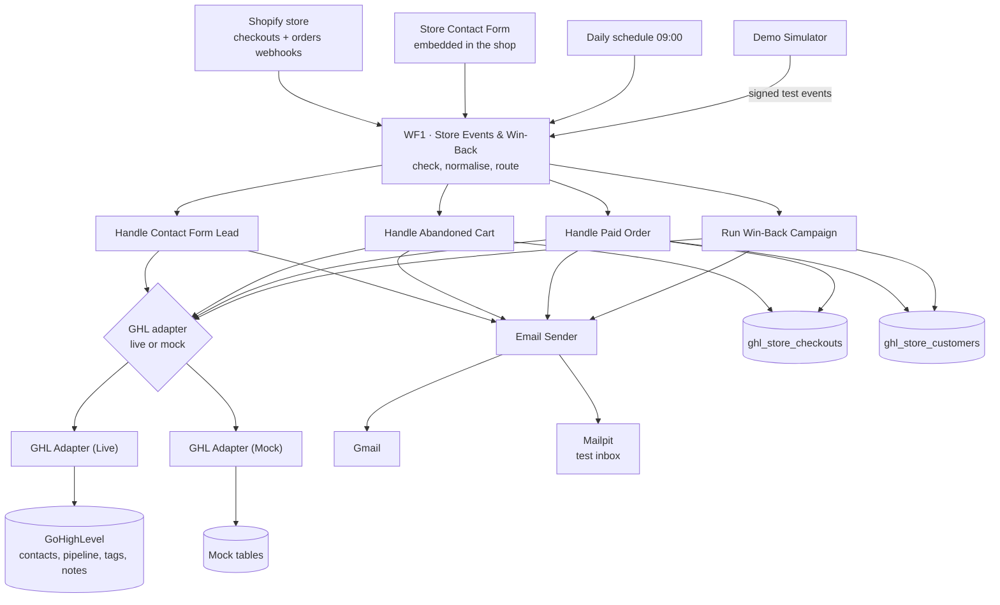

The main workflow only checks and routes. Each handler does one job and calls two services: the **Email Sender** (Gmail, Mailpit or both) and a **GHL adapter**. The adapter is chosen by one setting: **live** talks to GoHighLevel, **mock** writes the same actions into n8n Data Tables, so you can try the whole system with no GoHighLevel account.

---

## WF1: Store Events & Win-Back

The entry point. It runs on every webhook call to `/webhook/ghl-store-intake`, every day at 09:00 for the win-back, and by hand.

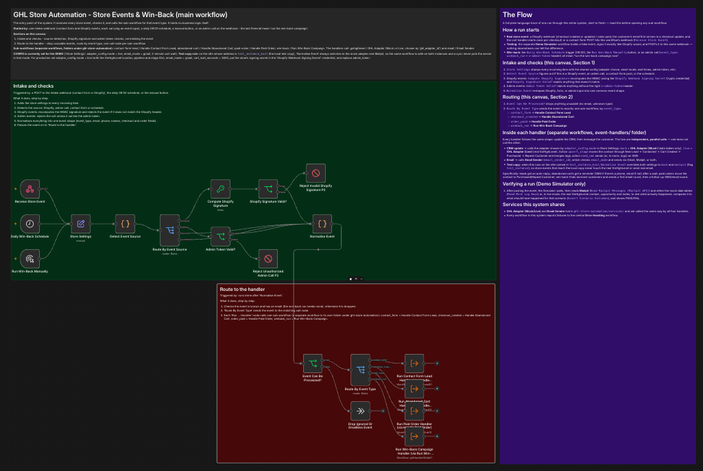

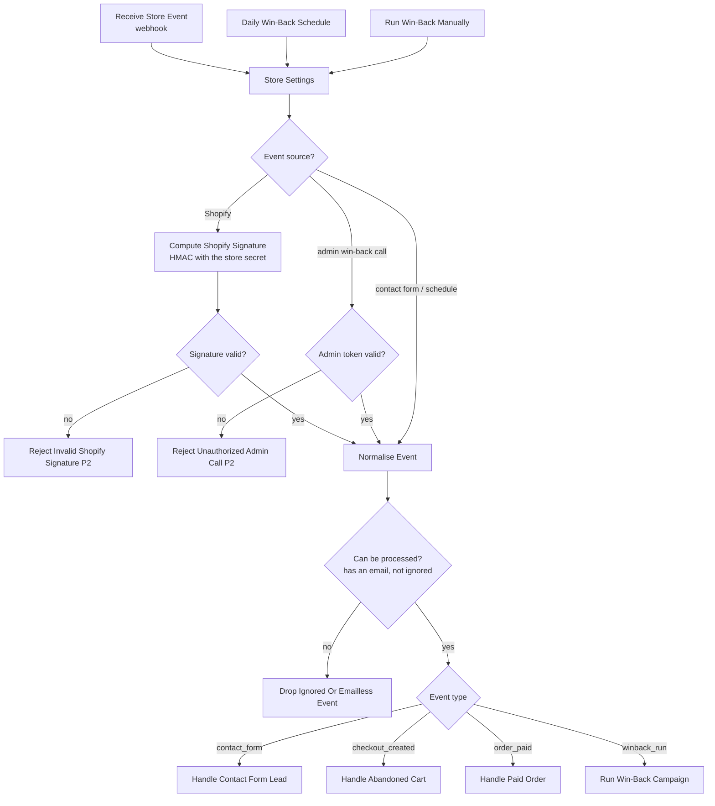

- **Store Settings** holds every value you tune: cart wait, win-back days, email mode, store URL, offer text, reply time, sender address, admin token, the GoHighLevel IDs and which adapter to use.
- **Shopify events that count:** `checkouts/create`, `checkouts/update` while the checkout is not completed (Shopify adds the email only in an update), and `orders/paid`. Every other topic is dropped.
- **Normalise Event** turns every source into one shape: `event_type`, `email`, `phone`, `first_name`, `last_name`, `message`, `checkout_id`, `recovery_url`, `cart_items`, `cart_total`, `order_id`, `order_total`, `prior_order_count`. The name comes from what the customer typed at checkout (billing, then shipping address) before Shopify's saved customer. Phone numbers are cleaned to digits and a leading `+`.
- **Test copy rule:** on the n8n whose address contains `test_instance_host`, every event uses the mock adapter and Mailpit, whatever the settings say. You can point the store webhooks at a test copy and at production at the same time, and the test copy never writes to real customers.

## Handle Contact Form Lead

Called by WF1 for a `contact_form` event.

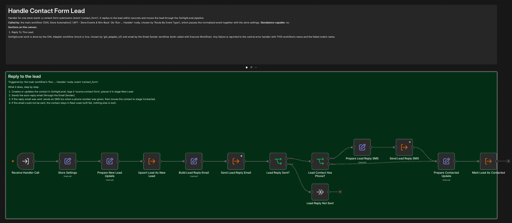

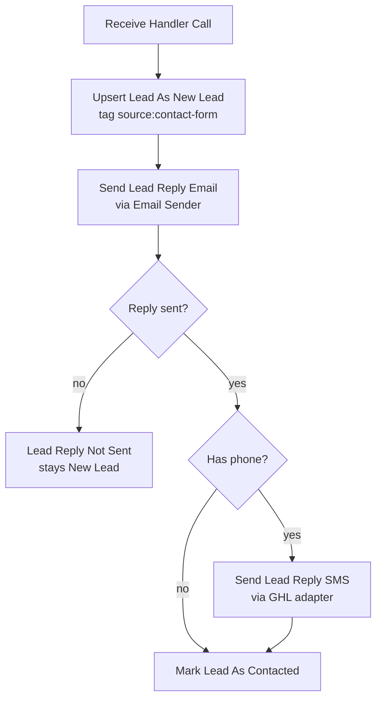

- The contact is created or updated in GoHighLevel with the tag `source:contact-form`, in stage **New Lead**.
- It moves to **Contacted** only after the reply email went out.

## Handle Abandoned Cart

Called by WF1 for every `checkout_created` event. Shopify sends many events for one checkout (12 in one real test), so this handler acts once per checkout.

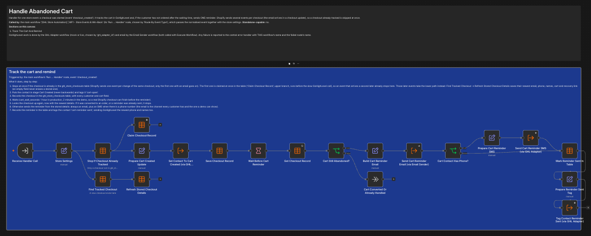

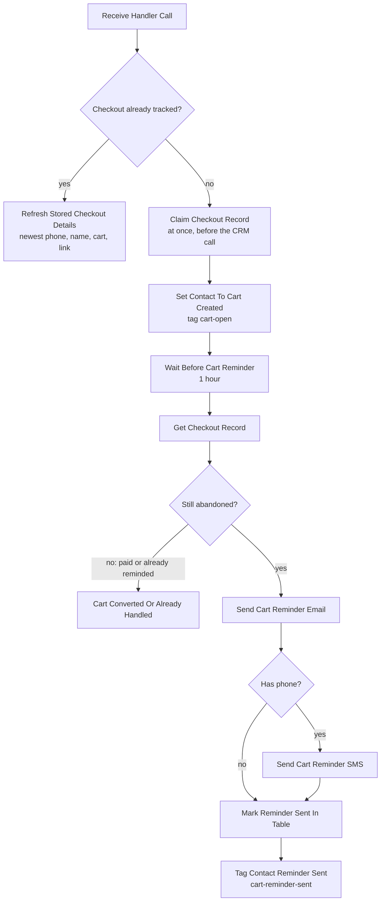

- **Claim first:** the checkout row is written before the 2.5-second CRM call. Without this, two events a second apart both passed and two reminders went out.
- **Refresh, then remind:** later events of the same checkout only update the stored row. After the wait, the reminder reads that row, so a phone number typed last still gets the SMS.
- **One reminder only:** the row records `reminder_sent_at`, and a paid order sets `converted_at`. Either one stops the reminder.
- The contact moves to **Cart Created**, unless it is already Purchased or Repeat Customer.

## Handle Paid Order

Called by WF1 for an `orders/paid` event.

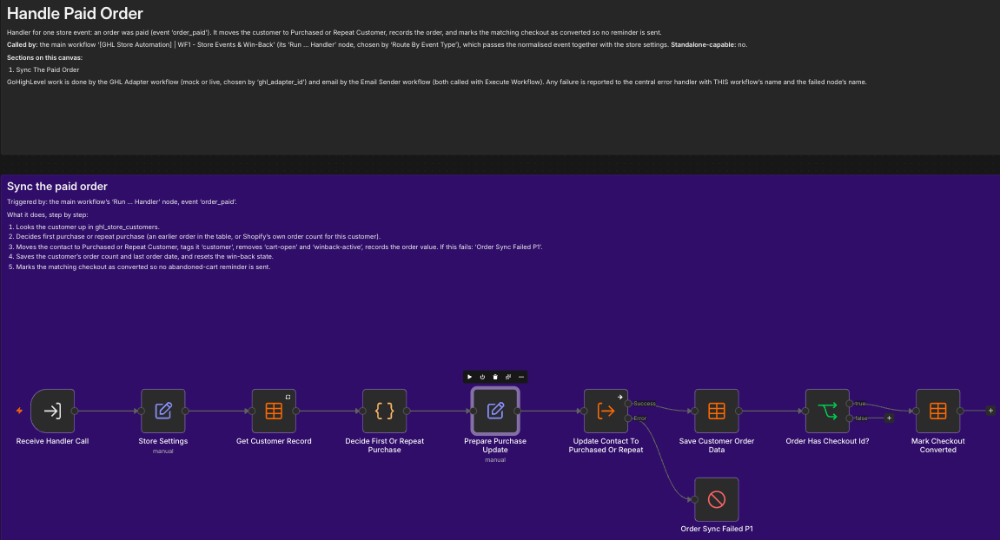

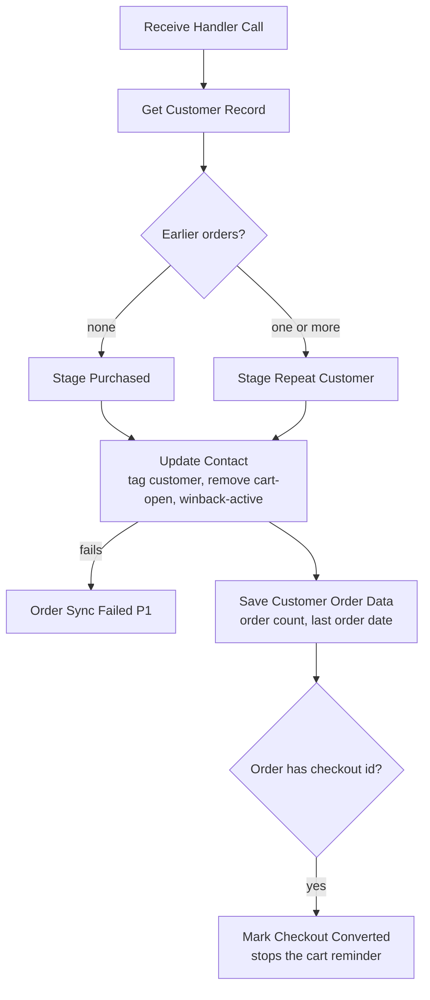

- A paid order is revenue, so a failed sync raises a **P1** alert (the highest).
- Saving the last order date is what the win-back reads later.

## Run Win-Back Campaign

Called by WF1 every day at 09:00, by hand, or by the Simulator.

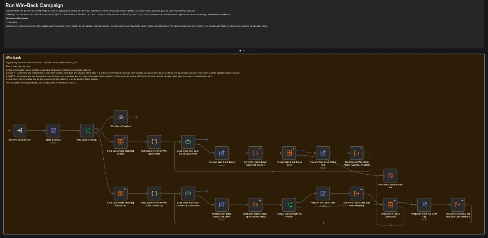

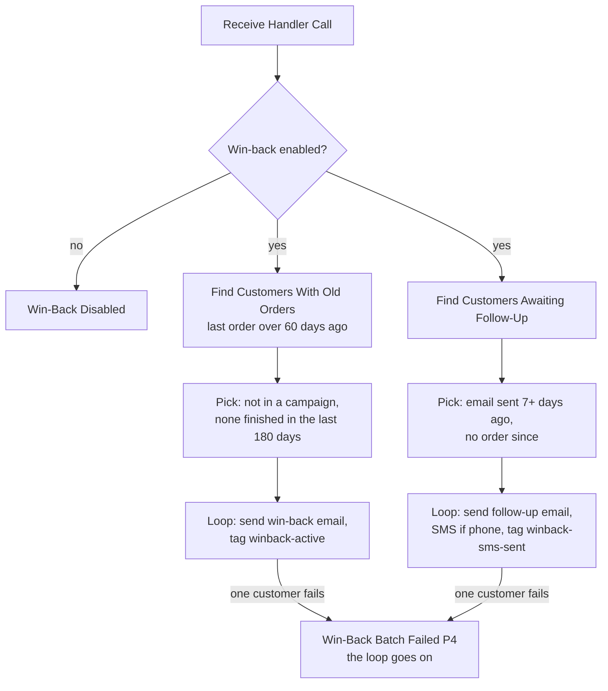

- Every customer is handled one by one: one failure does not stop the others.
- `winback_enabled` in Store Settings pauses the campaign without touching anything else.
- An order at any time moves the customer to Repeat Customer and clears `winback-active` (Handle Paid Order).

## Email Sender

A service every handler calls to send one email.

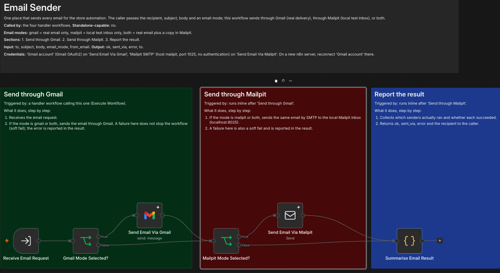

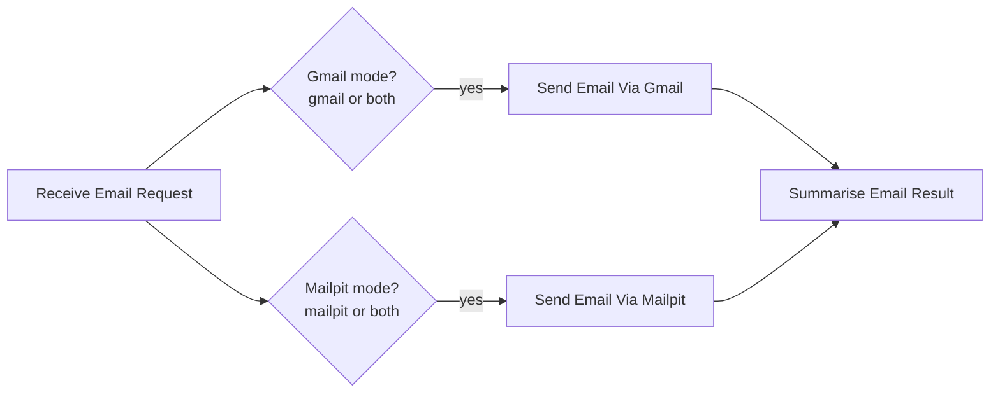

- `email_mode` in Store Settings: `gmail` (real delivery), `mailpit` (a local test inbox) or `both`.

## GHL Adapter (Live)

The service that talks to GoHighLevel. Every handler calls it with one action: `upsert_stage` (contact, tags, stage) or `send_sms`.

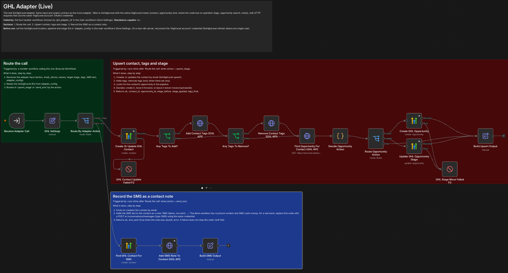

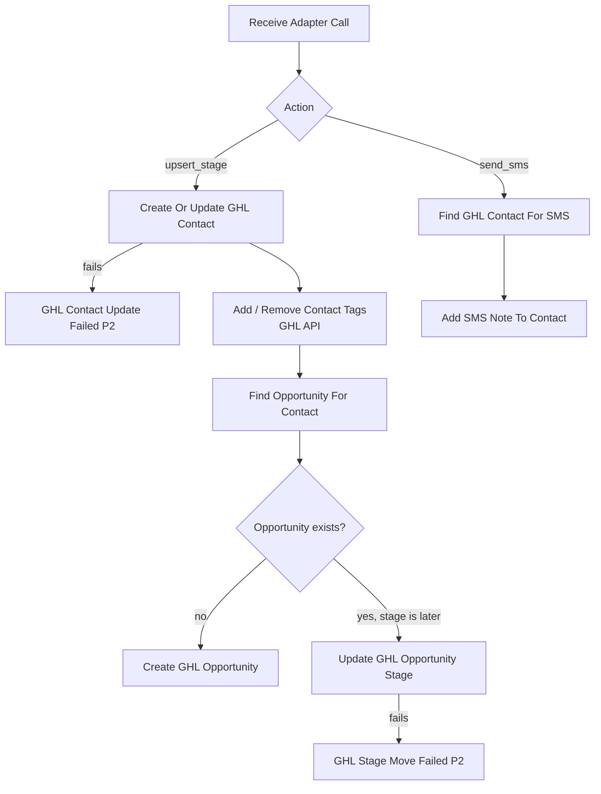

- Contacts and opportunities use the native HighLevel node; tags, the opportunity search and notes use the GoHighLevel API with the same OAuth2 connection.
- **Never backwards:** the stage moves only forward in New Lead → Contacted → Cart Created → Purchased → Repeat Customer.

## GHL Adapter (Mock)

Same input and output as the live adapter, but it writes to two n8n Data Tables instead of GoHighLevel. Use it to try the system with no GoHighLevel account.

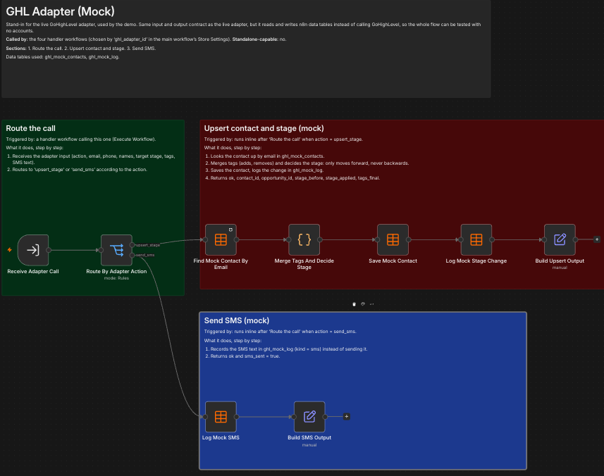

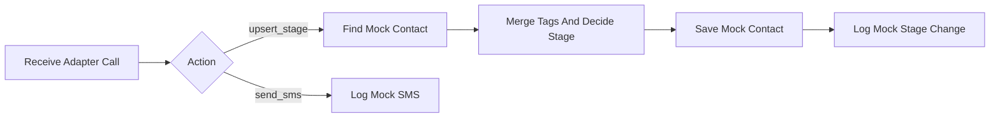

## Store Contact Form

A small n8n form you embed in the shop's Contact page. A visitor writes on the shop and becomes a lead.

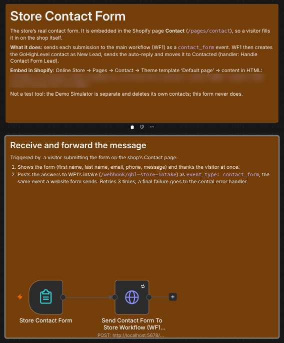

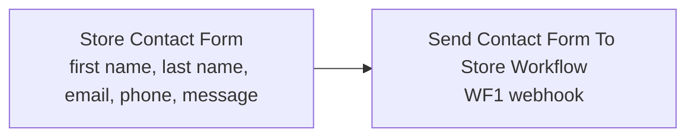

- In Shopify: **Online Store → Pages → Contact → Show HTML**, then paste `<iframe src="https://YOUR_N8N_HOST/form/store-contact" width="100%" height="760" style="border:0"></iframe>`.

## Demo Simulator

A test tool. It plays a customer against the real workflows, waits, then checks what really happened.

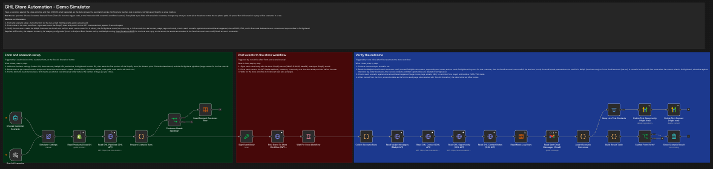

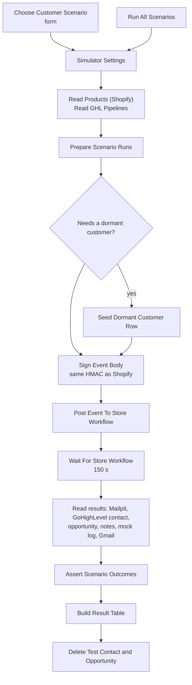

| Scenario | What it sends | What must happen |
|---|---|---|
| Form filler | a contact form | stage Contacted, tag `source:contact-form`, reply email |
| Cart abandoner | a checkout, no order | stage Cart Created, reminder email (and SMS note with a phone), tag `cart-reminder-sent` |
| Buyer | a checkout, then its paid order | stage Purchased, **no** reminder |
| Repeat buyer | a paid order with an earlier order | stage Repeat Customer |
| Dormant customer | a customer row 61 days old, then a win-back run | win-back email, tag `winback-active` |

- It uses the store's first real product, signs each event like Shopify does, and deletes every GoHighLevel test contact and opportunity it created at the end.
- The demo cart wait is 2 minutes (so a person can finish a real checkout first); the Simulator checks after 150 seconds.

---

## Messages it sends on its own

| When | To whom | What |
|---|---|---|
| Seconds after a contact form | the lead | the reply email (and SMS) |
| 1 hour after a checkout, if not paid | the shopper | one cart reminder email (and SMS) |
| Every day at 09:00 | customers with a last order 60+ days ago | the win-back email |
| Every day at 09:00 | customers who got the win-back email 7+ days ago and did not order | the follow-up email (and SMS) |

---

## How it stays reliable

- **Signed events only.** Every Shopify call is checked with the store's HMAC secret. A bad signature stops with a **P2** alert. Admin calls (the win-back on demand) need the `x-admin-token` header.
- **Once per checkout.** The checkout is claimed in a table before anything slow happens; repeated Shopify events only refresh the row.
- **Never backwards.** A stage move to an earlier stage is refused.
- **Forced alert levels** for the central error handler: `Order Sync Failed P1`, `Reject Invalid Shopify Signature P2`, `GHL Contact Update Failed P2`, `GHL Stage Move Failed P2`, `Win-Back Batch Failed P4`.
- **Soft fails** on messages: if a reply email fails, the lead stays New Lead and the run goes on; one failed win-back customer does not stop the batch.
- **Sub-workflows are locked** to their callers, so nothing else can start a handler by mistake.
- Every workflow sends its errors to your error workflow (`YOUR_ERROR_WORKFLOW_ID`). The [Error Handling](../error-handling/) system in this repo is one you can use.

---

## Data

Four n8n Data Tables. Create them by hand in n8n (**Overview → Data tables → Create**) with the exact columns below, then put each table's ID in the nodes that use it.

**`ghl_store_checkouts`**: one row per Shopify checkout.

| Column | Type | What it holds |
|---|---|---|
| `checkout_id` | string | Shopify checkout token, links the checkout to its order |
| `email` | string | the shopper's email |
| `created_at` | date | first event of the checkout |
| `converted_at` | date | set when the order is paid |
| `reminder_sent_at` | date | set when the reminder went out |
| `phone` | string | newest phone number seen |
| `first_name`, `last_name` | string | newest name seen |
| `cart_items` | string | for example "Blue jacket x1" |
| `cart_total` | number | cart value |
| `recovery_url` | string | Shopify's link back to the checkout |

**`ghl_store_customers`**: one row per customer who ordered; the win-back reads it.

| Column | Type | What it holds |
|---|---|---|
| `email` | string | the customer's email |
| `ghl_contact_id` | string | the GoHighLevel contact |
| `first_name`, `last_name`, `phone` | string | contact details |
| `order_count` | number | paid orders so far |
| `last_order_date` | date | date of the last paid order |
| `winback_state` | string | empty, `email_sent` or `done` |
| `winback_started_at` | date | when the win-back email went out |
| `winback_last_completed` | date | when the last campaign finished (180-day cool-down) |

**`ghl_mock_contacts`** (mock adapter only): `email`, `contact_id`, `stage`, `tags` (all string).

**`ghl_mock_log`** (mock adapter only): `ts` (date), `run_id`, `kind`, `email`, `detail` (string): every contact, stage move and SMS the mock adapter recorded.

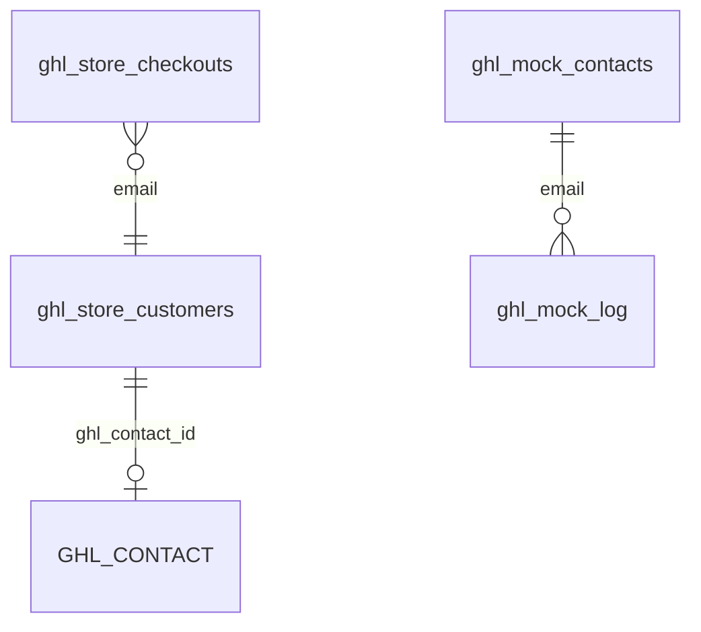

GoHighLevel holds the pipeline **Store Customers** with five stages in this order: New Lead, Contacted, Cart Created, Purchased, Repeat Customer. Create it by hand in GoHighLevel (**Opportunities → Pipelines**).

Tags used: `source:contact-form`, `cart-open`, `cart-reminder-sent`, `customer`, `winback-active`, `winback-sms-sent`.

---

## Setup

1. **Import** the 10 files (in n8n: **Workflows → Create workflow → ⋯ → Import from file**). Import the services first, then the handlers, then WF1, the form and the Simulator.
2. **Create the 4 Data Tables** above.
3. **Credentials**, one each:
   - **HighLevel OAuth2**, for the live adapter and the Simulator ([n8n docs](https://docs.n8n.io/integrations/builtin/credentials/highlevel/)). Not needed with the mock adapter.
   - **Crypto**, named *Shopify Webhook Signing Secret*, holding your store's webhook signing key (Shopify: **Settings → Notifications → Webhooks**).
   - **Gmail OAuth2**, for `email_mode` gmail or both ([n8n docs](https://docs.n8n.io/integrations/builtin/credentials/google/)).
   - **SMTP** to [Mailpit](https://mailpit.axllent.org/), for `email_mode` mailpit or both (host `mailpit` or `localhost`, port 1025, no login).
   - **Shopify OAuth2**, only for the Simulator ([n8n docs](https://docs.n8n.io/integrations/builtin/credentials/shopify/)).
4. **Connect the workflows.** Each handler calls services and WF1 calls handlers by workflow ID: open every *Execute Workflow* node and pick the right workflow from the list. In **Store Settings**, set `ghl_adapter_live_id`, `ghl_adapter_mock_id` and `email_sender_id` to the new IDs. In each sub-workflow's settings, set *This workflow can be called by* to its callers.
5. **Replace the placeholders:**

| Placeholder | Where | What to put there |
|---|---|---|
| `YOUR_GHL_LOCATION_ID` | WF1 Store Settings, Simulator Settings | your GoHighLevel sub-account (location) ID |
| `YOUR_GHL_PIPELINE_ID` | WF1 Store Settings | the Store Customers pipeline ID |
| `YOUR_GHL_STAGE_ID_NEW_LEAD` … `_REPEAT_CUSTOMER` | WF1 Store Settings | the ID of each of the 5 stages |
| `ADMIN_TOKEN` | WF1 Store Settings, Simulator Settings | a long random string, the same in both; while it stays `ADMIN_TOKEN`, admin calls are refused |
| `YOUR_TEST_N8N_HOST` | WF1 Store Settings | part of your test n8n's address, or leave it: then the settings always apply |
| `YOUR_CHECKOUTS_DATA_TABLE_ID`, `YOUR_CUSTOMERS_DATA_TABLE_ID`, `YOUR_MOCK_CONTACTS_DATA_TABLE_ID`, `YOUR_MOCK_LOG_DATA_TABLE_ID` | Data Table nodes | the table IDs (or pick the table from the list) |
| `YOUR_ERROR_WORKFLOW_ID` | every workflow's settings | your error workflow, or clear it |
| `YOUR_N8N_HOST` | Store Contact Form note | your n8n address, for the iframe |
| `REPLACE_WITH_YOUR_CREDENTIAL_ID` | credentialed nodes | select your credential in the node |

6. **Store Settings**: set `store_url`, `from_email`, `offer_text`, `response_time`, `email_mode`, and `adapter_config.mode` (`live` or `mock`). `cart_wait_seconds` is 120 for the demo; set 3600 for 1 hour.
7. **Shopify webhooks** (**Settings → Notifications → Webhooks**, format JSON): `Checkout creation`, `Checkout update` and `Order payment`, all to `https://YOUR_N8N_HOST/webhook/ghl-store-intake`.
8. **Publish** the services, then the handlers, then WF1 and the form.
9. **Test** with the Demo Simulator (**Run All Scenarios**) and check the PASS/FAIL table.

---

## Try it

| Do this | You should see |
|---|---|
| Send the contact form with your email | the reply email in seconds; the contact in **Contacted** with `source:contact-form` |
| Start a checkout on the shop, type an email, leave | after the wait, one reminder email; the contact in **Cart Created** with `cart-reminder-sent` |
| Same, but finish the payment | the contact in **Purchased**, no reminder |
| Pay a second order with the same email | the contact in **Repeat Customer** |
| Simulator: *Dormant customer* | the win-back email; tag `winback-active` |
| Simulator: *Run All Scenarios* | five PASS rows |

---

## Known limits

- SMS in a GoHighLevel sandbox is saved as a note, not sent. A real send needs a GoHighLevel phone number (and carrier registration in the US).
- Shopify's checkout refuses email domains that do not resolve (for example `example.test`); use a real domain for store tests.
- The win-back reads only customers this system has seen order. Older customers need a one-time import into `ghl_store_customers`.
- Only Shopify is supported as the store. Another platform needs a change in *Normalise Event* only.

## Files

| File | What it is |
|---|---|
| `wf1-store-events-and-win-back.json` | WF1: intake, checks, routing, win-back schedule |
| `handler-contact-form-lead.json` | Handle Contact Form Lead |
| `handler-abandoned-cart.json` | Handle Abandoned Cart |
| `handler-paid-order.json` | Handle Paid Order |
| `handler-win-back-campaign.json` | Run Win-Back Campaign |
| `service-email-sender.json` | Email Sender (Gmail, Mailpit or both) |
| `service-ghl-adapter-live.json` | GHL Adapter (Live): GoHighLevel |
| `service-ghl-adapter-mock.json` | GHL Adapter (Mock): n8n Data Tables |
| `utility-store-contact-form.json` | Store Contact Form, for the shop's Contact page |
| `demo-simulator.json` | Demo Simulator: five scenarios and a PASS/FAIL table |
| `images/` | screenshots |
| `LICENSE` | MIT License |

## License

[MIT](LICENSE). You may use, change and share these workflows, also for paid work. They come as is, with no warranty.
