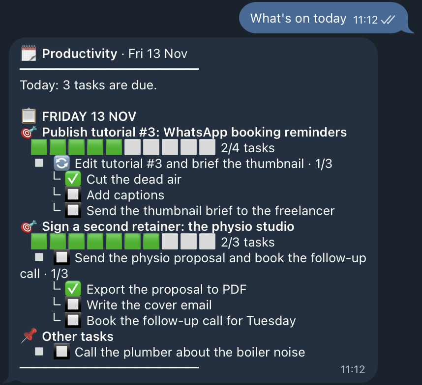
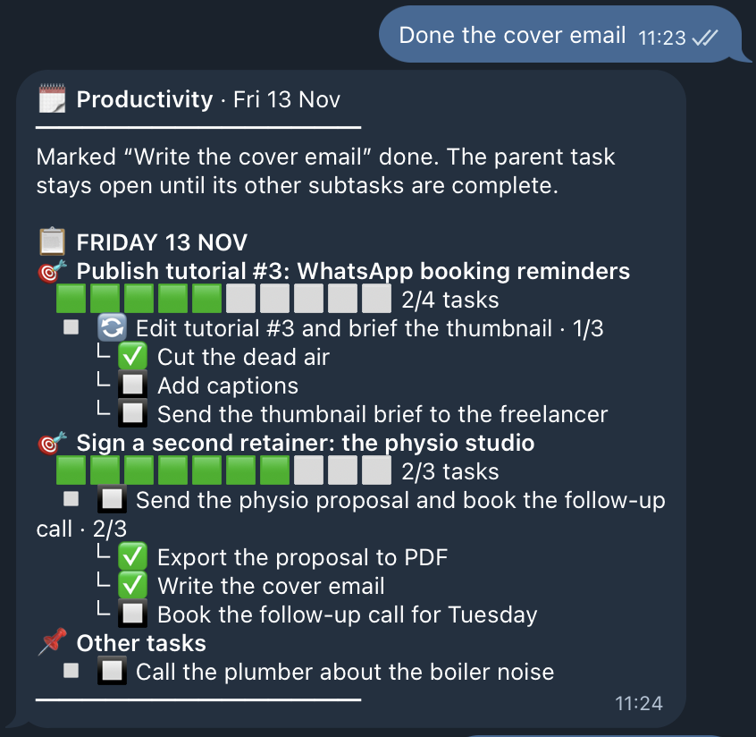
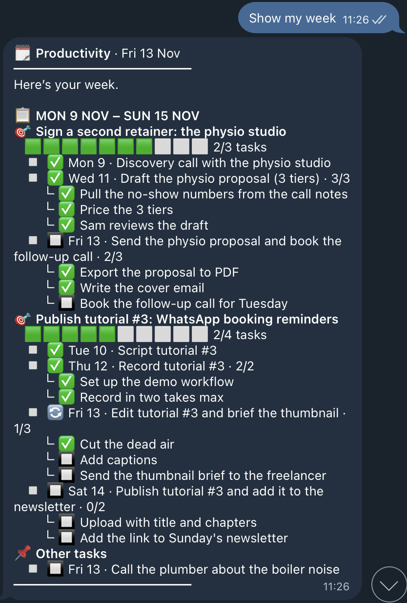
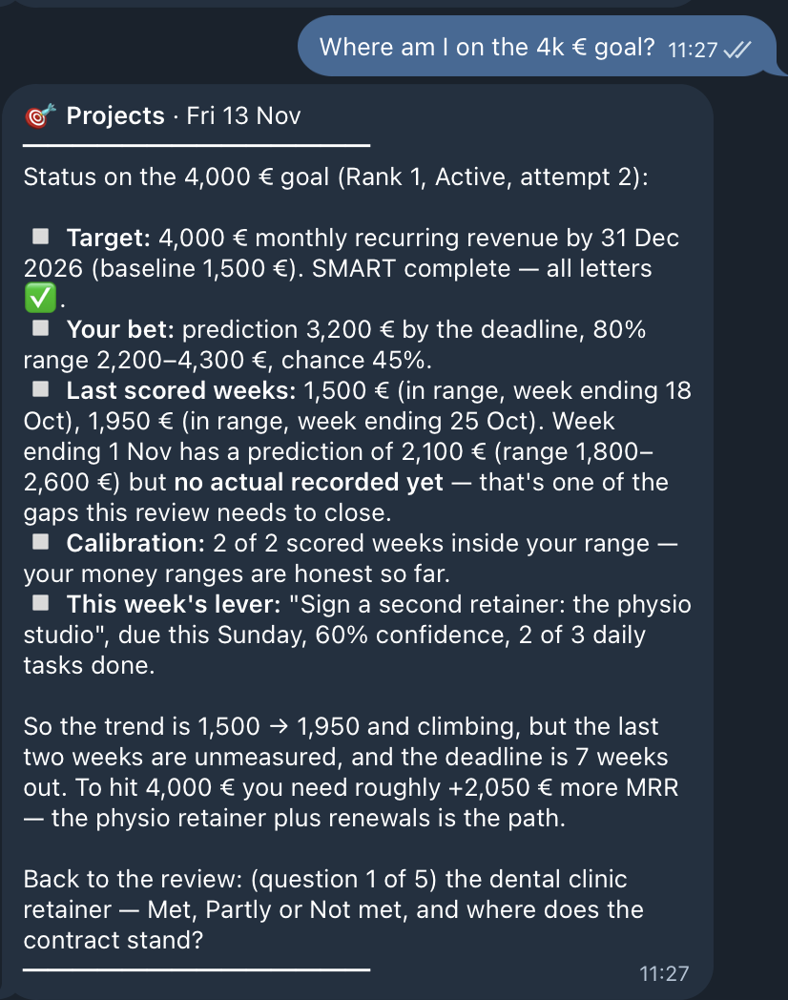
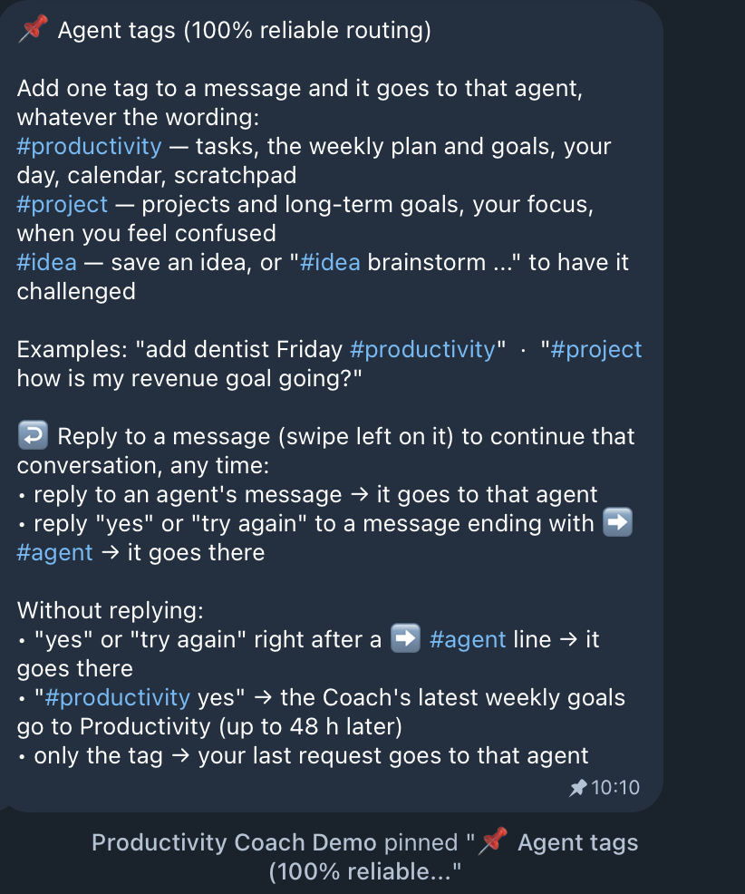
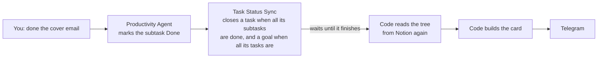
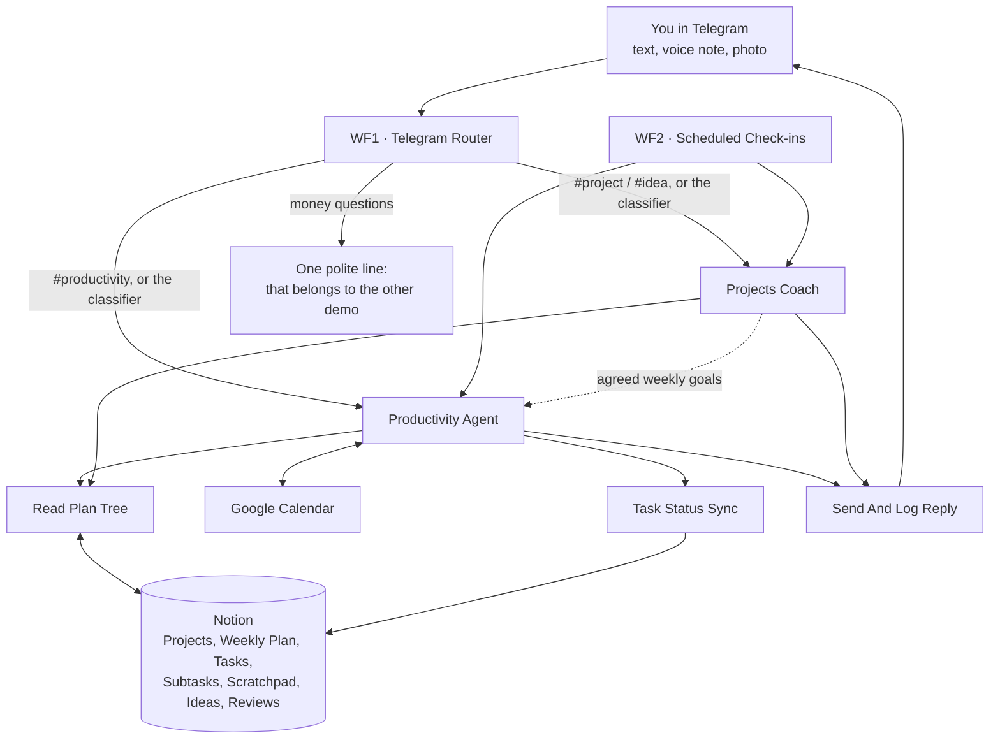
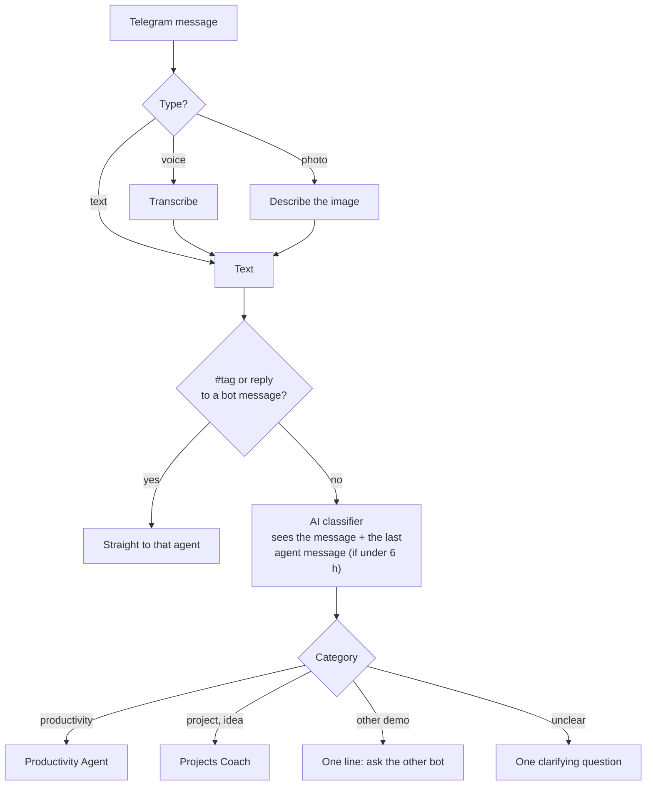
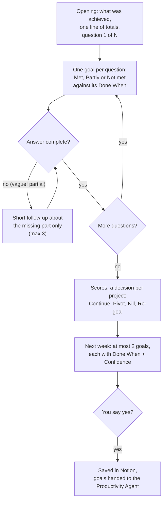
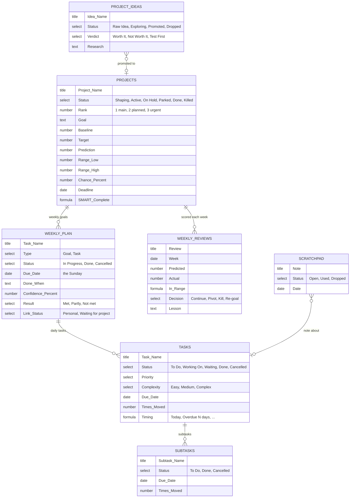

# Productivity Coach

**A planner and a goal coach in one Telegram chat, with Notion as the single source of truth.**

It plans your week and your day from the top down: long-term **projects**, the **weekly goals** that move them, the **daily tasks** for each goal and the **subtasks** of each task. It tells you what is on today, ticks things off when you say so, and every Saturday a coach reviews the week with you: what was met, what was not, and what is worth doing next week.

Built with n8n: 2 AI agents, 1 router, 1 scheduler, 3 services, and 7 Notion tables.

> The data in this demo is invented: Alex Rivera, a freelance automation consultant in Warsaw, his partner Sam and their daughter Mia. The system is a copy of a personal assistant that runs every day for a real person.

---

## In 30 seconds

1. **One tree, from outcome to action:** Project → weekly goal → daily task → subtask. Both agents read the same tree from Notion.
2. **The Productivity Agent** runs the week: goals, tasks, subtasks, the calendar and a scratchpad for quick notes.
3. **The Projects Coach** runs the long game: it turns a wish into a measurable bet, challenges new ideas with web research, and leads the Saturday review.
4. **Every reply that touches tasks comes with a card**, built by code from Notion after the write: goals, progress bars, tasks by day, subtasks.
5. **It speaks first:** a 07:00 plan and a 19:00 wrap-up on weekdays, and the weekly review on Saturday.

---

## What it looks like

| What's on today | Tick off a subtask | The whole week |
|---|---|---|
|  |  |  |

| The Projects Coach | Pinned agent tags |
|---|---|
|  |  |

---

## One output format, built by code

Every message has the same shape, and every list of tasks is the same card. The model never types the list.

```
🗓️ Productivity · Fri 13 Nov                         ← agent icon, agent name, date
━━━━━━━━━━━━━━                                        ← top bar
Marked "Write the cover email" done.                   ← 1-2 lines from the agent

📋 FRIDAY 13 NOV                                       ← the card, built by code from Notion
🎯 Sign a second retainer: the physio studio          ← weekly goal
   🟩🟩🟩🟩🟩🟩🟩⬜⬜⬜ 2/3 tasks                         ← goal progress
   ▫️ 🔲 Send the physio proposal and book the follow-up call · 2/3   ← task, subtasks done
        └ ✅ Export the proposal to PDF                 ← subtasks
        └ ✅ Write the cover email
        └ 🔲 Book the follow-up call for Tuesday
📌 Other tasks                                         ← tasks with no goal
   ▫️ 🔲 Call the plumber about the boiler noise
━━━━━━━━━━━━━━                                        ← bottom bar
```

- **The bars frame every reply,** so you always see where an answer starts and ends and which agent wrote it.
- **Status icons:** ✅ done, 🔄 working on, ⏳ waiting, ✖️ cancelled, 🔲 to do.
- **Nothing skipped, nothing repeated.** Every goal shows all its tasks, every task all its subtasks. The agent writes 1-2 lines and never retells the card.
- **The card always shows Notion after the write**, so what you see is what is saved.



The card waits for Task Status Sync to finish before it reads Notion. So when the last subtask closes, the task and the goal show as done in the same reply.

---

## The big picture



| Workflow | Starts on | Does |
|---|---|---|
| **WF1** Telegram Router | every Telegram message | turns voice and photos into text, picks the agent |
| **WF2** Scheduled Check-ins | 3 schedules | 07:00 plan, 19:00 wrap-up, Saturday review |
| **Productivity Agent** | called by WF1 or WF2 | goals, tasks, subtasks, calendar, scratchpad |
| **Projects Coach** | called by WF1 or WF2 | projects, ideas, focus, weekly review |
| **Read Plan Tree** | called by both agents | reads projects → goals → tasks → subtasks in one pass |
| **Task Status Sync** | every 12 h and after each Productivity reply | closes parents when their children are done, counts moves, keeps subtask dates in line |
| **Send And Log Reply** | called by the agents | formats the card, logs the turn, sends it |
| **Pin Tags Message** | once, by hand | pins the help message with the agent tags |

---

## WF1: how a message finds its agent



**Agent tags** skip the classifier: `#productivity`, `#project`, `#idea`. A reply to a bot message (swipe left) goes to the agent that wrote it. When an agent hands work to the other one, it ends with `➡️ #agent`; answer "yes" and the request moves there. The bot pins these rules in the chat (screenshot above).

---

## The Productivity Agent

- **Weekly goals.** Each goal belongs to an active project or is Personal. A goal from the Coach arrives with its quality bar ("Done when") and a confidence.
- **Daily tasks.** It proposes 2-5 tasks per goal, from today to Friday. A day you name always wins. At most 1-2 complex tasks a day, hardest first, all inside 09:00-17:00.
- **Subtasks.** Complex tasks get 2-5 subtasks, split across days when needed.
- **Proposals wait for a yes; orders do not.** "Plan my week" gives a proposal that is written only after "confirm". "Add X", "mark Y done" or "all done except Z" are written at once.
- **Calendar.** Anything with a clock time becomes a Google Calendar event (calls 15 min, meetings 1 h, else 30 min).
- **Scratchpad.** Quick notes and ideas, linked to the related task, never turned into tasks unless you ask.
- **Moves are counted.** Every time a task changes date, *Times Moved* goes up. A task moved 3 times gets the question: do it today, move it again, or cancel it?

### Its alerts

| When | Message |
|---|---|
| Mon-Fri, 07:00 | Today's plan: tasks due today (the card), open tasks from earlier this week (do today, move or cancel?), top 3 priorities, a time-blocked schedule around calendar events. Skipped if you already asked today. |
| Mon-Fri, 19:00 | Wrap-up: what is done, what is still open, follow-ups, top 3 for tomorrow. |

These reports start with no chat history and read Notion fresh, so they always show the plan as it is now.

---

## The Projects Coach

The coach is built to be **honest, numeric and short**. It does not cheer; it measures. Its style:

- **A project is an outcome, never a tool.** "4,000 € a month in recurring revenue", not "use Upwork". The tool goes into a weekly goal.
- **Every project is a bet.** It asks up to 3 rounds of questions (why, the number, the deadline, who, your honest chance), then writes the blockers (skill, resource, frame, physics) with an IF-THEN plan for each, the assumptions, a **prediction with an 80% range**, and a SMART checklist.
- **Calibration.** Each week the actual number is scored against your range: "2 of 2 scored weeks inside your range: your money ranges are honest so far." Over time you learn how good your forecasts are.
- **Focus mode** when you feel lost: every option in one table, the side-quest test ("if I skipped this for 30 days, would the main project change?"), a verdict, one strength and one weak spot from memory.
- **Ideas get challenged.** "#idea brainstorm ..." starts live web research. It answers only from the pages it found, with links, and gives a verdict: Worth It, Not Worth It, or Test First, with the cheapest test.

### The Saturday weekly review (18:00)

A conversation, one question per message:



If you miss Saturday, a review from Monday to Friday still scores last week and plans the current week. The workflow computes both weeks; the model never guesses dates.

---

## How it stays reliable

- **One shared reader.** *Read Plan Tree* gives both agents the same view of projects, goals, tasks and subtasks. If a project or goal was renamed, the agent is told (matched by page ID).
- **Parents and children stay in step, in code.** *Task Status Sync* closes a task when all its subtasks are done and a goal when all its tasks are done, counts date moves, and moves subtasks with their task. "Mark the task done" closes its open subtasks; "all done except the follow-up call" leaves that one open.
- **Action log.** After each turn, the agent saves in its chat memory the Notion writes it really made, from the tool results. "Try again" never creates duplicates.
- **Three kinds of memory:** the recent conversation (Postgres), the action log, and long-term Notion pages (planning rules, observations, strengths and weak spots for the coach).
- **Errors reach you.** If an agent fails, you get a message that names the agent and the request; "try again" resends it.

---

## The language model: Venice, or any provider you like

| Step | Model |
|---|---|
| Router classifier, Productivity Agent | a GPT model through Venice |
| Projects Coach | an open-weight GLM model, with a backup model if it fails |
| Voice notes | speech-to-text (`/audio/transcriptions`) |
| Photos | vision model (`/chat/completions` with an image) |
| Idea research | chat model with Venice web search on |

**Why Venice:** plans, goals and weekly reviews are personal. Venice offers private models that, by its own policy, do not store prompts or replies, and anonymised access to other models.

**Switch to another provider.** The chat models use n8n's standard *OpenAI Chat Model* node with the Venice base URL in the credential:

| Provider | What to change |
|---|---|
| **OpenAI** | an OpenAI credential with the default base URL, then pick a model in each chat model node |
| **OpenRouter** | base URL `https://openrouter.ai/api/v1` and your OpenRouter key |
| **Anthropic** | replace each chat model node with n8n's *Anthropic Chat Model* node |

Voice, vision and web search are HTTP Request nodes in the OpenAI format. For web search on another provider, use its own search option or a search API.

---

## Notion: 7 tables



**The tree in Notion.** A weekly goal is a row of *Weekly Plan* (Type = Goal) due on its Sunday and linked to a project. Its daily tasks link to it, and each task holds its subtasks. One Notion relation per level, so any view (a board by day, a list by project) works without extra fields.

<details>
<summary>All columns, with types and options</summary>

**Projects:** Project Name (title); Status (select: Shaping, Active, On Hold, Parked, Done, Killed); Rank (number 1-3); Why, Goal, Out of Scope, Metric, Who, Checkpoints, Blockers, Assumptions, Parked Reason, Next Step, Notes (text); Baseline, Target, Chance %, Prediction, Range Low, Range High, Iteration (number); Deadline (date); Weekly Goals (relation, two-way with Weekly Plan.Project); Source Idea (relation, two-way with Project Ideas.Project); Weekly Reviews (relation, two-way with Weekly Reviews.Project); SMART Complete (formula: true when the SMART fields are all filled).

**Project Ideas:** Idea Name (title); Status (select: Raw Idea, Exploring, Promoted, Dropped); Category (select: Product, Marketing, Operations, Personal, Other); Why Interesting, Next Step, Success Metric, Cheapest Test, Verdict Reason, Research (text); Target, Prediction (number); Test By, Date Added (date); Verdict (select: Worth It, Not Worth It, Test First); Project (relation).

**Weekly Reviews:** Review (title, "<project> - week ending <Sunday>"); Week (date); Project (relation); Predicted, Range Low, Range High, Actual (number, money projects only); In Range (formula); Decision (select: Continue, Pivot, Kill, Re-goal); Lesson (text).

**Weekly Plan:** Task Name (title); Type (select: Goal, Task); Status (select: In Progress, Done, Cancelled); Priority (select: Urgent, High, Medium, Low); Complexity (select: ★ Easy, ★★ Medium, ★★★ Complex); Due Date (date; a goal is due on its Sunday); Day (select: Monday … Friday, Sunday); Time Estimate (select: 15 min, 30 min, 1 hour, 2+ hours); Times Moved (number); Project (relation); Link Status (select: Personal, Waiting for project); Done When (text); Confidence % (number); Result (select: Met, Partly, Not met); Daily Tasks (relation, two-way with Tasks.Weekly Item); Timing (formula).

**Tasks:** Task Name (title); Status (select: To Do, Working On, Waiting, Done, Cancelled); Priority (select: High, Medium, Low); Complexity (select); Due Date (date); Notes, Owner (text); Times Moved (number); Weekly Item (relation); Subtasks (relation, two-way with Subtasks.Task); Timing (formula: No date, Closed, Overdue N days, Today, Upcoming).

**Subtasks:** Subtask Name (title); Status (select: To Do, Done, Cancelled); Due Date (date); Times Moved (number); Task (relation); Timing (formula).

**Scratchpad:** Note (title); Status (select: Open, Used, Dropped); Date (date); Task (relation); Project (relation).

**Memory pages:** "Productivity Memory", "Projects Coach Memory" and "Shared Memory". One line per fact: `- **ID** · YYYY-MM-DD · text · src:user|observed`.

**Log table (n8n Data Table):** chat_id, agent, slot, log_date, user_message, agent_reply (text); user_message_id, reply_message_id (number).

</details>

---

## Setup

You need: a recent n8n version (the workflows use Data Tables and the MCP Client node), a Telegram bot, a Notion workspace, a Google Calendar, an OpenAI-compatible LLM key (Venice in the demo), and a Postgres database for the chat memory.

1. **Telegram:** create a bot with [@BotFather](https://core.telegram.org/bots#how-do-i-create-a-bot) and add a *Telegram API* credential in n8n. Send `/start`; your chat ID is `message.chat.id` in the first execution.
2. **Google Calendar:** create a calendar for the assistant and add a *Google Calendar OAuth2* credential. The calendar ID is under Settings → Integrate calendar.
3. **Notion:** create the 7 tables and the 3 memory pages above under one page and share it with a Notion integration. Add a *Notion API* and a *Notion MCP* credential.
4. **LLM:** an *OpenAI* credential with your provider's base URL (Venice: `https://api.venice.ai/api/v1`).
5. **Postgres:** a *Postgres* credential for the chat memory.
6. **Data Table:** an n8n Data Table with the log columns above.
7. **Import** in this order: the three `service-` files, the two `agent-` files, `wf2-scheduled-check-ins`, `wf1-telegram-router`, `utility-pin-tags-message`. If n8n gives a workflow a new ID, select the right workflow again in each *Execute Workflow* node.
8. **Replace the placeholders:**

   | Placeholder | Value |
   |---|---|
   | `YOUR_TELEGRAM_CHAT_ID` | your chat ID |
   | `YOUR_CALENDAR_ID` | your calendar ID |
   | `YOUR_NOTION_..._DATA_SOURCE_ID` | the data source ID of each table |
   | `YOUR_NOTION_..._PAGE_ID` | the ID of each memory page |
   | `YOUR_LOG_DATA_TABLE_ID` | the Data Table ID |
   | `YOUR_ERROR_WORKFLOW_ID` | any workflow with an Error Trigger |
   | `REPLACE_WITH_YOUR_CREDENTIAL_ID` | select your credential in each node |

9. **Test** by hand, then publish WF1, WF2 and Task Status Sync, and run *Pin Tags Message* once.

---

## Try it

| You send | What happens |
|---|---|
| `what's on today?` | One line plus the card: today's tasks under their weekly goals, with subtasks. |
| `done the cover email` | The subtask is ticked; the card shows 2/3 on its task. |
| `show my week` | Every goal of the week, its tasks by day, every subtask. |
| `plan my day` | Top 3 priorities and a 09:00-17:00 schedule around calendar events. |
| `new weekly goal: launch the template shop landing page` | Linked to a project (or it asks which one), 2-5 tasks proposed with subtasks; written after "confirm". |
| `add to scratchpad: thumbnail with a robot holding a coffee` | Saved and linked to the related task. |
| `where am I on the 4k € goal?` | The coach: target, your bet, scored weeks, calibration, this week's lever. |
| `I'm confused: newsletter or clients?` | Focus mode: options in one table, a verdict. |
| `weekly review` | The review conversation, one question at a time. |
| `how much did I spend on coffee?` | One line: money belongs to the [Budget Coach](../budget-coach/). |
