# Vacancy Outreach

**Turn open job vacancies into sales conversations for a recruiting or staffing agency.**

A company that has had a job open for weeks is struggling to hire. This system finds those companies, writes each hiring contact a short personal email that offers matching candidates, lets you approve every email in Telegram, sends it, follows up, and sorts the replies.

Built with n8n: 4 workflows and one Google Sheet.

<p align="center"><a href="https://youtu.be/DE-Y3OhYy2g"></a><br><b>▶ <a href="https://youtu.be/DE-Y3OhYy2g">Watch the 5-minute demo on YouTube</a></b></p>

---

## In 30 seconds

1. **Find** companies with open roles that match what the agency places (Google Jobs, or a sample list for demos).
2. **Score** each job with a language model, using the agency's bench of available candidates.
3. **Draft** a short email for the best matches and send it to **Telegram** for review: Approve, Reject or Edit.
4. **Send** the approved emails from Gmail, then **follow up** after 3 and 7 days, unless the company replied.
5. **Read the replies**: suggest an answer to an interested contact, opt out anyone who says stop, pause anyone who says not now.
6. **Report** the numbers every Monday in Telegram.

Nothing is sent to a company without your approval.

---

## The big picture

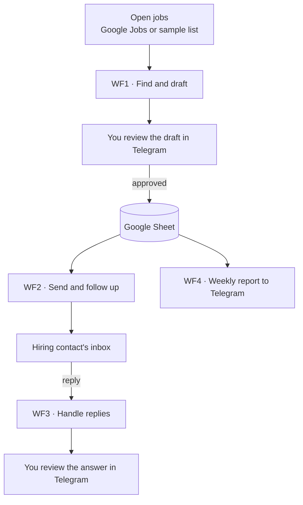

The Google Sheet is the only link between the workflows. Each workflow reads it, does its job and writes the result back.

| Workflow | Runs | Does |
|---|---|---|
| **WF1** Find And Draft Leads | daily, 07:00 | finds and scores jobs, drafts emails, asks for approval |
| **WF2** Send And Follow Up | daily, 09:00 | sends approved emails and the follow-ups |
| **WF3** Handle Replies | every minute | reads replies and acts on them |
| **WF4** Send Weekly Report | Monday, 08:00 | sends a short summary to Telegram |

---

## WF1: find and draft

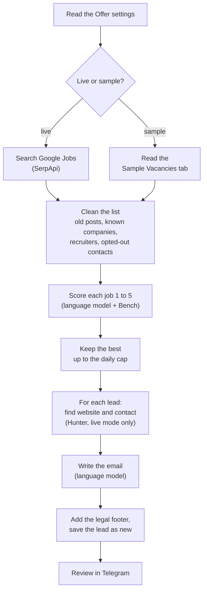

**What makes a good lead.** A direct employer (not a recruiter or a job board), a role that matches what the agency places, a post 14 to 45 days old (they are struggling), and a candidate on the Bench in the same region. Those score 5.

**What the model reads.** In live mode, Google's job highlights (qualifications, responsibilities, benefits) followed by the job text, up to 1,500 characters. In sample mode, the description in the sheet.

**Contract or permanent.** Each job and each Bench candidate can say `Contract`, `Permanent` or both. The model only sees the candidates whose type fits the job. A job or a candidate without a type matches everything.

**Honest emails.** The model writes 90 to 120 words, names the role and the company, and uses only facts from the job post and the Bench. It never invents names, numbers or promises.

---

## The review in Telegram

Every draft arrives in Telegram with three buttons.

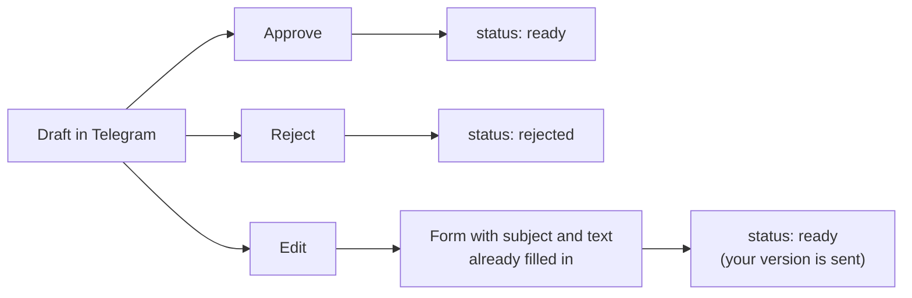

Each tap opens a short confirmation page: **Approved**, **Rejected** or **Opening the editor**. No answer within 24 hours leaves the lead untouched.

<p align="center">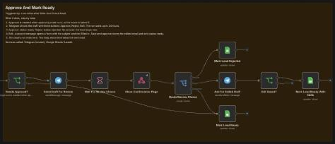<br><sub>The approval section of WF1 in n8n.</sub></p>

<p align="center">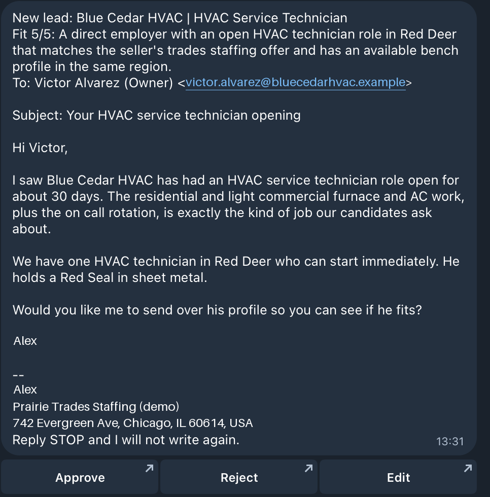</p>
<p align="center"><i>A draft as it arrives in Telegram: why it scored 5/5, who receives it, the email with its legal footer, and the three buttons. (Real screenshot, personal data replaced.)</i></p>

<table>
<tr>
<td align="center" width="50%">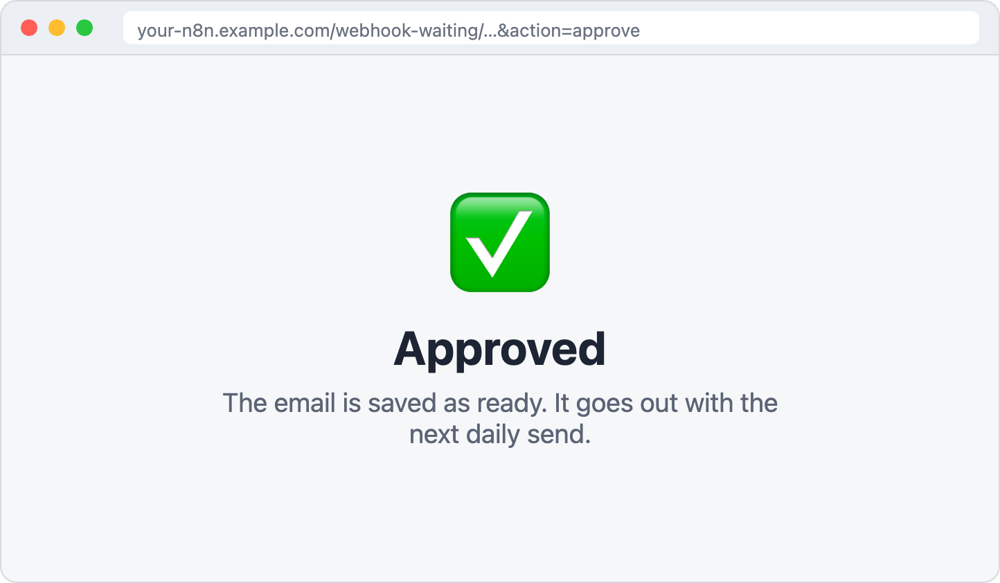<br><i>After a tap: the confirmation page.</i></td>
<td align="center" width="50%">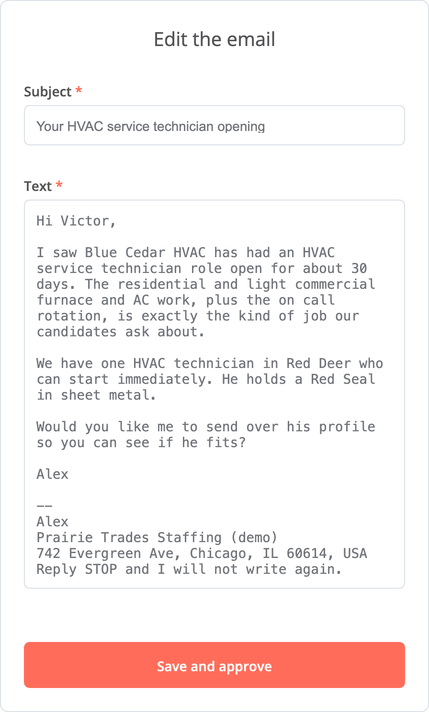 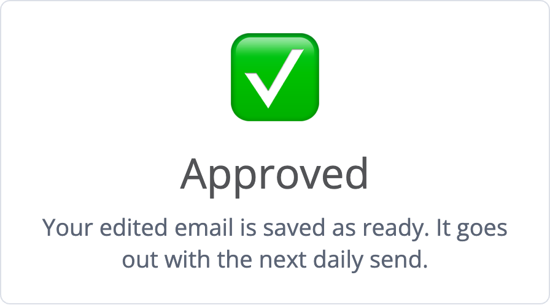<br><i>Edit: the form opens filled in. After saving: approved.</i></td>
</tr>
</table>

---

## WF2: send and follow up

Every morning WF2 looks at each lead and decides what is due.

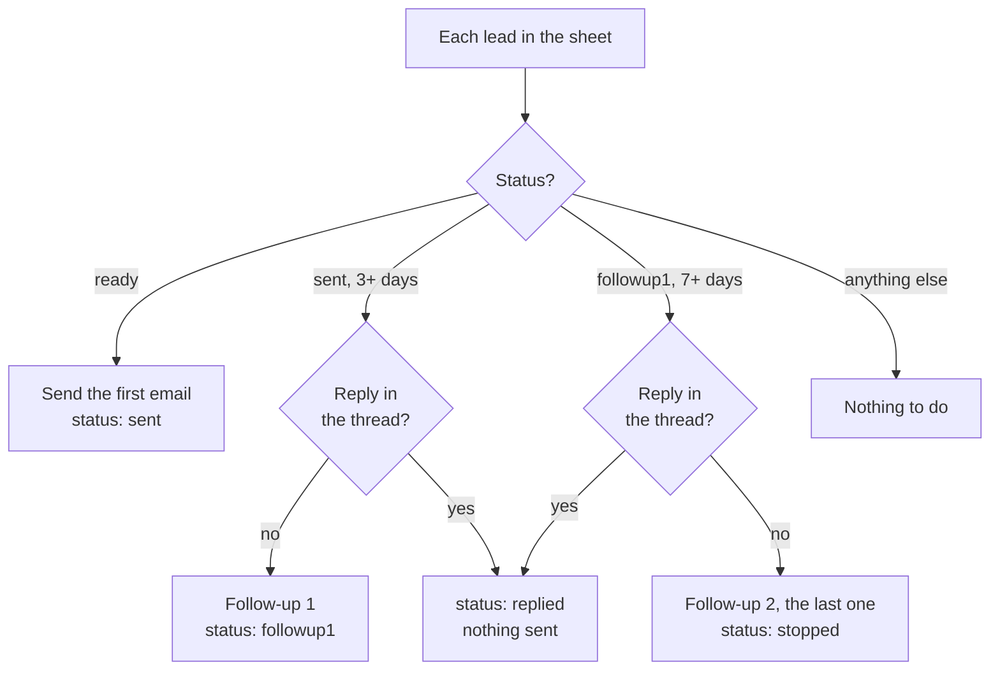

| Day | What happens |
|---|---|
| 0 | First email |
| 3 | Short follow-up in the same thread: "If it helps, I can send two or three profiles." |
| 7 | Last note: "If the timing is not right, no problem, I will not write again." |

- Follow-ups are replies in the same email thread, sent only to the contact.
- Before each follow-up WF2 checks the thread itself. If anyone answered, it sends nothing. This is a safety net in case WF3 missed the reply.
- Days count in the workflow's time zone. Set it to your market (see Setup), so 09:00 means 09:00 for the prospect.
- After follow-up 2 the lead is `stopped`. It is **not** added to the opt-out list: the same company may be contacted about a new vacancy after 90 days.

---

## WF3: handle replies

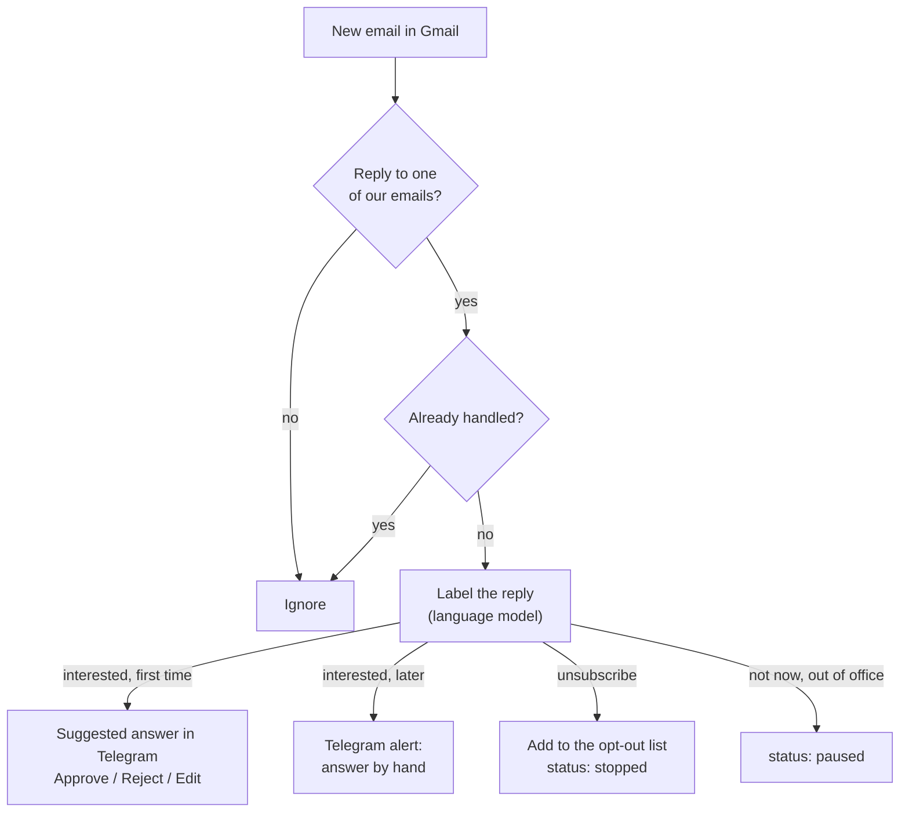

- **The first interested reply** gets a suggested answer. It uses the job post and the first email, so it does not ask for facts already known.
- **Later replies** only send an alert with a link to the thread. By then the conversation needs CVs, attachments and a personal touch.
- **Stop or unsubscribe** puts the email and the whole company domain on the opt-out list. Nobody there is contacted again.
- **Duplicates:** the Gmail trigger can deliver the same email twice. Every handled reply id is stored on the lead, so a copy is skipped.

<table>
<tr>
<td align="center" width="50%">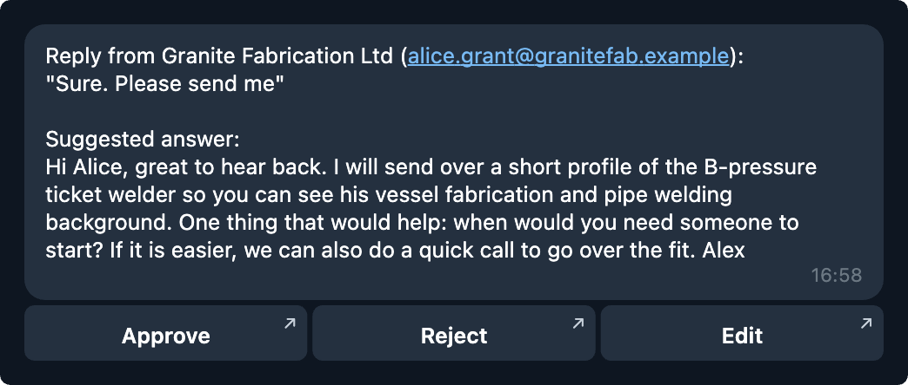<br><i>First interested reply: a suggested answer to review.</i></td>
<td align="center" width="50%">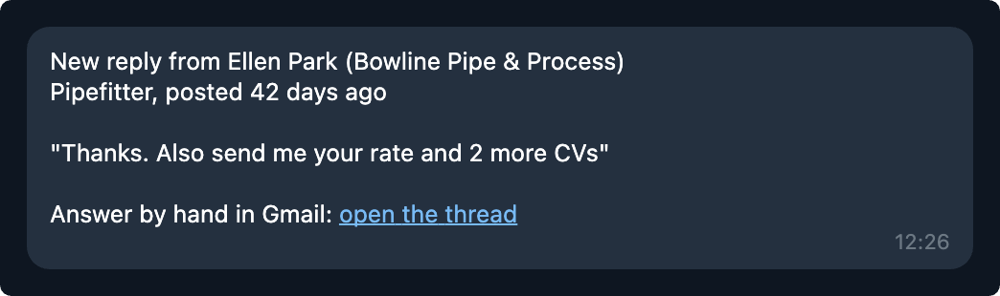<br><i>Later reply: an alert, you answer by hand.</i></td>
</tr>
</table>
<p align="center"><sub>Telegram messages recreated from a test run, in the exact format the workflow sends.</sub></p>

---

## WF4: weekly report

Every Monday at 08:00, one message with the counts by status:

<p align="center">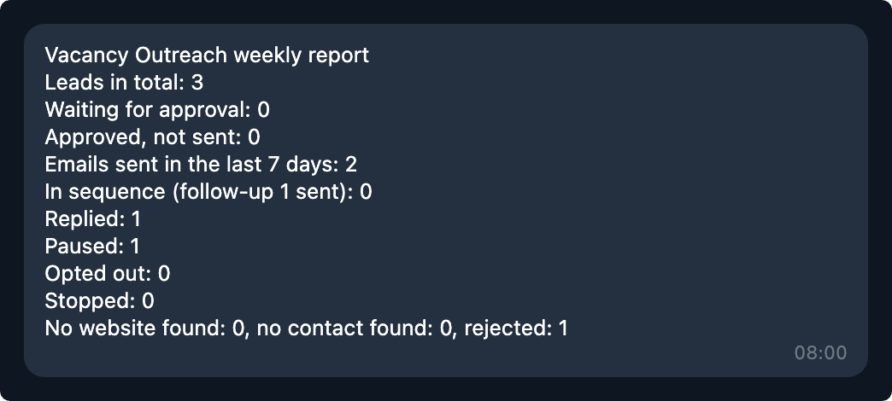<br><sub>Recreated from a test run.</sub></p>

---

## The Google Sheet

Import [`sample-sheet/Vacancy Outreach.xlsx`](sample-sheet/) into Google Sheets. It has five tabs:

| Tab | What it holds | Who writes it |
|---|---|---|
| **Offer** | the agency's settings: what it sells, where, the sender, the limits | you |
| **Bench** | anonymous candidates the agency can place: trade, certifications, region, availability, contract or permanent | you |
| **Leads** | one row per company contacted, with its status and dates | the workflows |
| **Suppression** | the opt-out list: email, domain, date, reason | WF3 (and you) |
| **Sample Vacancies** | 20 made-up jobs for demos and tests | you |

<details>
<summary><b>Offer settings</b></summary>

| Key | Example | Meaning |
|---|---|---|
| `what_we_sell` | Skilled trades staffing… | used in the emails |
| `who_buys` | Fabrication shops… | used for scoring |
| `signal_titles` | welder, electrician, … | the roles that count as a buying signal |
| `source_mode` | `sample` | `sample` = Sample Vacancies tab, `live` = Google Jobs |
| `location` | Calgary, Alberta, Canada | where to search in live mode |
| `skip_recruiters` | yes | drop staffing agencies and job boards |
| `max_post_age_days` | 45 | ignore older posts |
| `min_score` | 4 | lowest score that becomes a lead |
| `daily_cap` | 5 | new leads per day |
| `approval_mode` | on | `off` sends score-5 leads without review |
| `sender_name` | YOUR NAME | signs the emails |
| `sender_company` | Prairie Trades Staffing (demo) | |
| `postal_address` | a real address | in every footer (anti-spam law) |
| `tone` | Short, friendly, plain words | style of the emails |

</details>

### Lead statuses

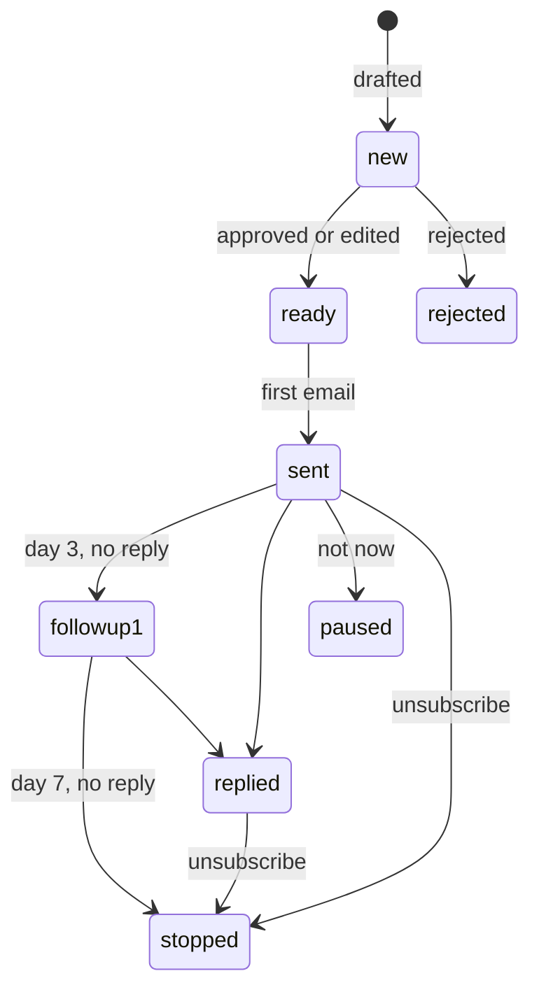

`no_domain` and `no_contact` mark live leads where Hunter found no website or no hiring contact.

---

## Setup

**You need:** n8n (cloud or self-hosted), a Google account (Sheets and Gmail), a Telegram bot, and an API key for a language model (I use Venice; OpenAI, Claude and others work too, see [Language model](#language-model)). For live mode only: [SerpApi](https://serpapi.com) and [Hunter](https://hunter.io) keys.

1. **Sheet:** in Google Sheets choose File → Import → Upload `sample-sheet/Vacancy Outreach.xlsx` → *Create new spreadsheet*. Copy its id from the URL (`/d/<id>/edit`). The Leads tab holds 6 example rows from a test run: look at them, then delete them (keep row 1) before your first run.
2. **Placeholders:** open the four `.json` files in a text editor and replace:
   - `YOUR_SPREADSHEET_ID` with the sheet id,
   - `YOUR_TELEGRAM_CHAT_ID` with your Telegram chat id (send your bot a message, then open `https://api.telegram.org/bot<TOKEN>/getUpdates`).
3. **Import** the four files into n8n (Workflows → Import from file).
4. **Credentials:** open each workflow and select your own credentials on the nodes that show a warning: Google Sheets, Gmail, Telegram, your language model (see below), Hunter, SerpApi.
5. **Offer tab:** set `sender_name`, `postal_address` and what you sell. The run stops while the placeholders are there.
6. **Sample Vacancies tab:** the contacts use `.example` addresses, which never receive mail. Put your own address in `contact_email` (for example `you+prairiesteel@gmail.com`), so test emails reach you.
7. **Time zone:** WF2 → ⋯ → Settings → Timezone → your market (for example `America/Edmonton`).
8. **Test** in sample mode: publish WF1 (its loop calls a block of itself, and n8n only calls published workflows), run it, approve a draft in Telegram, run WF2, reply to the email, publish WF3, run WF4.
9. **Go live** when you are ready: `source_mode` = `live`, publish all four.

> **Before you email real people:** keep `approval_mode` on, use a real postal address, and check the anti-spam rules of your market (CASL in Canada, CAN-SPAM in the US, GDPR in the EU). This project is a demo, not legal advice.

---

## Language model

Three steps use a language model: **scoring** and **writing** in WF1, **reply labels** in WF3. Each one is a pair of nodes:

- *Build … Request* (Code) prepares the request: model, prompt and the JSON shape of the answer.
- *Score Vacancy Fit / Write Outreach Email / Label Reply* (HTTP Request) sends it.
- *Read … Answer* (Code) checks and reads the answer.

I use **[Venice](https://venice.ai)** with `z-ai-glm-5-3-flash`: cheap, private and OpenAI-compatible. A full daily run costs a few cents. Any provider works. To switch:

| Provider | HTTP Request URL | Credential | Model (in the 3 *Build* nodes) | Other changes |
|---|---|---|---|---|
| Venice (as shipped) | `https://api.venice.ai/api/v1/chat/completions` | "OpenAI API" credential with your Venice key | `z-ai-glm-5-3-flash` | none |
| OpenAI | `https://api.openai.com/v1/chat/completions` | "OpenAI API" credential with your OpenAI key | e.g. `gpt-4.1-mini` (check OpenAI's current list) | delete `reasoning_effort: 'low'` unless the model is a reasoning model |
| Claude | `https://api.anthropic.com/v1/messages` | "Header Auth": name `x-api-key`, value your Anthropic key | e.g. `claude-haiku-5-5` | different request and answer format, see below |

<details>
<summary><b>Switching to Claude, step by step</b></summary>

Claude's Messages API is not OpenAI-compatible, so the request and the answer change a little.

**1. In the 3 HTTP Request nodes:** set the URL and the Header Auth credential from the table, and add the header `anthropic-version: 2026-10-21`.

**2. In the 3 *Build … Request* nodes,** change the `request` object. Before (OpenAI format):

```js
request: { model: 'z-ai-glm-5-3-flash', temperature: 0, max_tokens: 3000, reasoning_effort: 'low',
  messages: [{ role: 'system', content: system }, { role: 'user', content: user }],
  response_format: { type: 'json_schema', json_schema: { name: 'vacancy_fit', strict: true, schema } } }
```

After (Claude format): the system prompt moves to its own field, `temperature` goes, and the JSON shape moves into `output_config`:

```js
request: { model: 'claude-haiku-5-5', max_tokens: 3000,
  system: system,
  messages: [{ role: 'user', content: user }],
  output_config: { effort: 'low', format: { type: 'json_schema', schema } } }
```

(In each node the system and user variables have their own names, for example `systemFor(benchFor(l))`; keep them.)

**3. In the 3 *Read … Answer* nodes,** read Claude's answer shape:

```js
// before
const ch = r.choices && r.choices[0];
if (!ch || ch.finish_reason !== 'stop' || !ch.message || !ch.message.content) { throw ... }
o = JSON.parse(ch.message.content);

// after
const block = (r.content || []).find(b => b.type === 'text');
if (r.stop_reason !== 'end_turn' || !block) { throw ... }
o = JSON.parse(block.text);
```

</details>

Free-plan limits of the other services: Hunter 50 credits a month, SerpApi 250 searches a month.

## Known limits

- Replies are matched by email thread. A prospect who writes a new email instead of replying is not matched.
- Live job data comes from a search API, not from a licensed job feed.
- A paused lead stays paused until you change its status by hand.

## Files

| File | What it is |
|---|---|
| `wf1-find-and-draft-leads.json` | WF1 |
| `wf2-send-and-follow-up.json` | WF2 |
| `wf3-handle-replies.json` | WF3 |
| `wf4-send-weekly-report.json` | WF4 |
| `sample-sheet/Vacancy Outreach.xlsx` | the Google Sheet with sample data |
